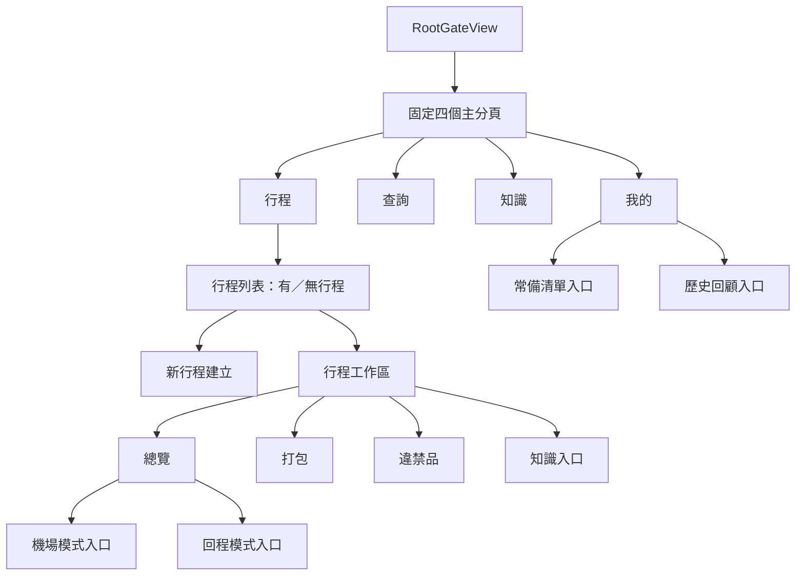
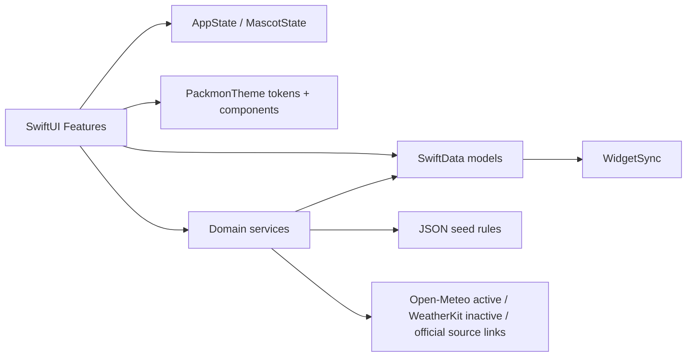

# Packmon 專案架構

## 一句話

Packmon 是 SwiftUI + SwiftData 的原生 iOS App；畫面層只組合狀態與語意元件，打包、違禁品、天氣與小工具同步由既有 Service 負責。

## 結構 C 導航

## 程式邊界

## 資料流

- `Trip` 是行程聚合根，關聯 `PackingItem` 與既有 `Expense`。
- `TripCreationFlowView` 建立並寫入 `Trip`，接著呼叫 `PackingListGenerator.sync`。
- `PackingListGenerator` 讀取使用者偏好、日期／天氣標籤與 JSON 規則，合併成 SwiftData 清單。
- `CanIBringService` 同時比對目的地海關、回程海關與航空安檢資料；獨立查詢與行程違禁品共用同一份資料來源。
- 第 4 階段候選：`WeatherService` 負責供應商及有效快取（PD-035：Open-Meteo 啟用、WeatherKit 保留未啟用）；`WeatherPlanning` 負責日期／完整性／城市季節規則；`WeatherDraft` 管理取消、逾時及晚到結果。建立流程固定 `Trip.packingWeatherRaw`；打包頁只呈現此快照，不因開啟而查詢並合併。舊行程無快照時不回填歷史天氣。詳見 [天氣規格](weather-integration-spec.md)；候選不等於人工驗收。
- `WidgetSync` 在行程、清單狀態改變或 App 離開前景時同步摘要。

## 設計系統

- 唯一 token 入口：`SharedUI/PackmonDesignSystem.swift`。
- Feature 經由 `@Environment(\.packmonTheme)` 讀取顏色、間距、圓角。
- `PackmonThemeID` 讓現行版與「結構 C」並存；測試人員可在「我的 → 偏好與外觀」直接切換。
- 共用元件目前包含卡片、列卡、狀態膠囊、主按鈕與 Packmon 吉祥物。

## 第一階段範圍

已接通：行程列表、新行程、總覽、打包、違禁品、獨立查詢。

只保留入口：機場模式、回程模式、我的、常備清單、歷史回顧、行程知識。
