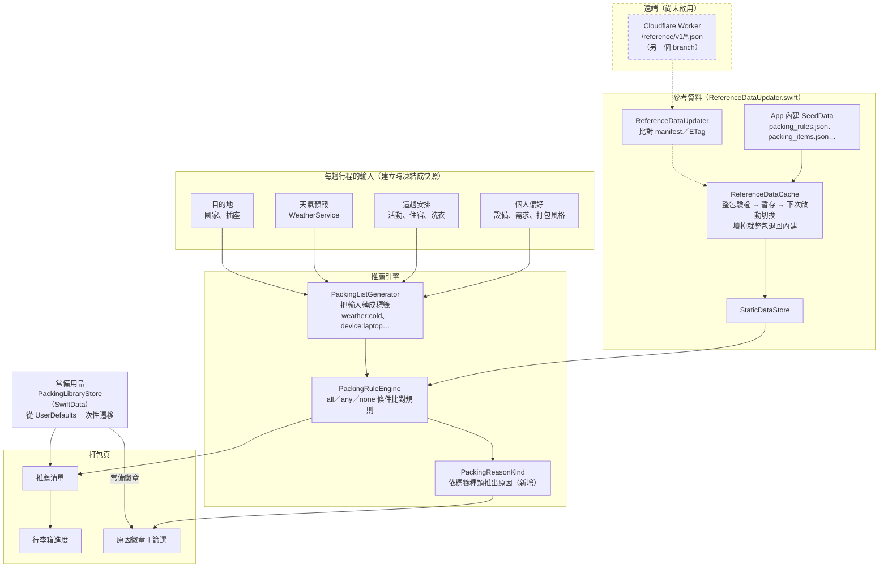

# PackSmart 後端調整說明（`feature/visual-packing`）

日期：2026-10-20。

Cloudflare Worker 已拆到另一個 branch `feature/cloudflare-worker`，不在這個 PR 裡；它需要先補一筆 PD 才能合併，待決事項寫在該 branch 的 `backend/worker/README.md`。

## 架構圖

所有推薦都在 App 裡完成，不需要伺服器。虛線框的部分還沒啟用：遠端網址沒有設定，所以目前只用 App 內建的資料。

**怎麼讀這張圖**
- **參考資料**：規則和用品目錄平常讀 App 內建的版本。之後如果設定了遠端網址，App 會在背景下載新版本，驗證完整後，下次啟動才換上；任何檔案有問題就整包退回內建版本。
- **推薦流程**：建立行程時，偏好、這趟安排、天氣、目的地會轉成標籤（例如 `weather:cold`），規則引擎依標籤挑出要帶的用品和數量。
- **原因徽章**：同一條規則檢查的是哪一類標籤，就決定徽章類別。例如 `weather:` 是天氣、`device:` 是你的設定。常備徽章則來自常備用品清單。

## 1. 後端整合（原 PR #1，App 內）

- **推薦政策**：固定的 Swift 條件改成單一 JSON 標籤引擎（`packing_rules.json`，`all`／`any`／`none` 條件），用品以 ID 與需求索引對應。
- **常備用品**：從 UserDefaults 改存到獨立的 SwiftData 個人庫，一次性遷移，保留 ID、數量、重量與順序，原始 defaults 不覆寫。
- **參考資料**：下載後整包驗證、暫存，下次啟動才切換；任何一個檔案壞掉就整包退回 App 內建的資料。
- **沒有偏好快照的舊行程**：改用固定的一般／手機預設，不再隨裝置的全域偏好變動。
- **Release 版**：不讀取 AI key，`Secrets.plist` 排除在產物之外。
- 推薦輸出與整合前完全相同：2,916 組相容性比對通過。

## 2. 推薦引擎新增原因分類（`PackingRuleEngine.swift`）

- 新增 `PackingReasonKind`：依每條規則檢查的標籤種類，推出物品被加入的原因，分為天氣、這趟安排、你的設定、目的地、常備。打包頁的原因徽章就是用這個資料畫的。
- `none` 條件刻意不產生徽章：因為「沒有某個標籤」而觸發的規則是未調整的預設。例如沒有洗衣時的衣物沒有徽章，有洗衣而減量時才標「這趟安排」。
- 這只是顯示用的資料，推薦結果本身不變：2,916 組 oracle 和 540 組矩陣的測試都照樣通過。
- `BackendRegression` 新增 `reasonKinds()` 測試，記錄在 PD-061。

## 希望檢視的地方

1. **常備用品遷移是單向的**：遷移後的修改只寫入 SwiftData，直接 revert 會讀回舊的 defaults，遷移後的新修改會遺失。
2. **原因分類的規則合不合理**：標籤種類對應徽章的方式（例如 `style` 算「你的設定」、`none` 不算調整）是否符合直覺。
