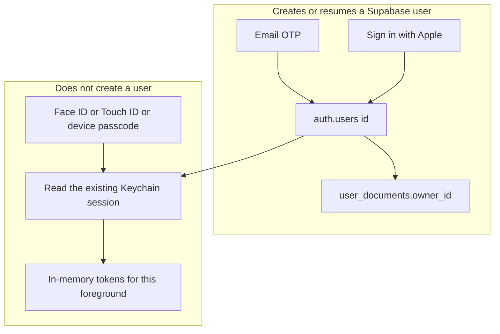
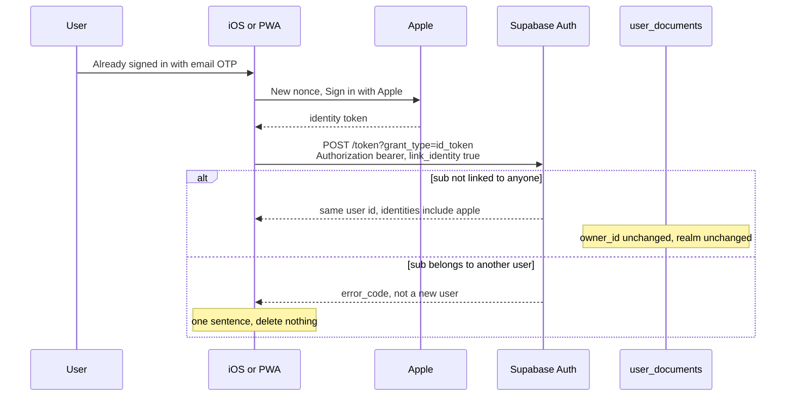
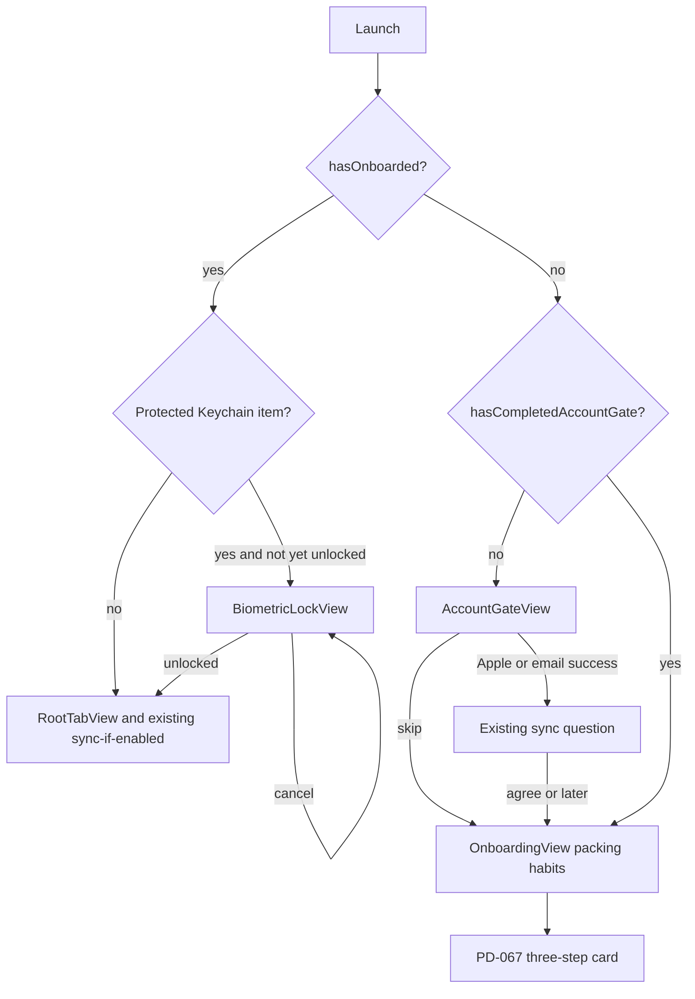

# Sign in with Apple, and Face ID as a local unlock

| | |
|---|---|
| Author | PackSmart engineering (placeholder) |
| Date | 2026-11-07 |
| Status | PR 1–4 implemented 2026-11-07 (buttons hidden). PR 5 (in-app Face ID unlock) was built and then dropped at the owner's request: Face ID is left to iOS ("Require Face ID", iOS 18+), see PD-068. PR 6 waits for a real Apple Developer team, bundle id, and PWA origin |
| Product | PackSmart (iOS target `TravelGenius`, web client `pwa/`) |
| Decision | Proposed **PD-068**. Does not edit PD-062, PD-066, or PD-067 in place. |
| Supabase | Project ref `vjhclgfhdiaykamvthpb`, region `ap-southeast-1`, Postgres 17 |

## Overview

PackSmart login is email plus a 6-digit OTP through Supabase Auth. The iOS app calls Auth REST itself (`TravelGenius/Services/Cloud/SupabaseClient.swift`). The PWA does the same in `pwa/js/cloud.js`. There is no password. The product owner asked for Apple account login and Face ID login. Those are not the same thing, and this design does not pretend they are.

**Sign in with Apple is the identity.** It creates or resumes one Supabase user via `POST auth/v1/token?grant_type=id_token`. On iPhone, Apple's own sheet already uses Face ID or the device passcode to approve that sign-in. **Face ID is not an account.** A separate Face ID step only re-unlocks a session that Apple or email already established and that this device stored in the Keychain. It must not create a Supabase user, must not upload, and must not delete local trips when it fails.

Email OTP stays. After either sign-in succeeds, the existing sync-consent question still runs. Login still does not upload. The web client gets Sign in with Apple and keeps email OTP. It does not get a Face ID button.

## Background and motivation

PD-062 made Supabase the only cloud account and made SwiftData the local copy. PD-066 put email OTP on first launch and kept 「先略過，試用看看」. PD-067 shortened that copy to one sentence and added the three-step trip guide. `docs/supabase-plan.md` still lists "email only, or also Apple?" as an open question. This design answers it.

What the code does today:

- `CloudAccount.Phase` is `unconfigured`, `signedOut`, `awaitingCode(email:)`, or `signedIn(email:)`. There is no locked state.
- `SupabaseClient.sendCode` posts `auth/v1/otp` with `create_user: true`. `verify` posts `auth/v1/verify` with `type: email` and a 6-digit token. `supabase/config.toml` sets `[auth.email] otp_length = 6` and points the magic-link and confirmation templates at `supabase/templates/login-code.html`, which must contain `{{ .Token }}`. Custom SMTP is already set. This design does not change those login templates.
- The session (`accessToken`, `refreshToken`, `expiresAt`, `userID`, `email`) is stored by `SupabaseSessionStore` under service `PackSmart.SupabaseSession`, accessibility `kSecAttrAccessibleAfterFirstUnlockThisDeviceOnly`, with no biometry and no keychain access group. The PWA stores the same shape in `localStorage` key `packsmart.session`.
- A fresh iOS install deletes the leftover Keychain item when `cloud.installed` is missing (`CloudAccount.init`). UserDefaults, including `syncEnabled`, do not survive uninstall.
- `TravelGeniusApp` calls `synchronizeIfEnabled()` whenever `scenePhase` becomes `.active`. That function returns immediately unless `syncEnabled` is true and `phase` is `.signedIn`. Writes go only through `public.sync_document`. `owner_id` is `auth.uid()` and is not accepted from the client (`supabase/migrations/202610260001_user_documents.sql`). Expenses, budget, and the medical card are not in the payload. Health-category items need `health_sync_consent` on user metadata.
- The device sync bookmark is `realm = "{host}|{userUUID}"` (`SupabaseConfiguration.realm(for:)`). If the bookmark exists and the new user id differs, `CloudSyncEngine.synchronize()` throws `CloudSyncError.differentAccount` and does not upload. PD-062's "no account switching" rule is still in force.
- First launch is `RootGateView`: if `hasOnboarded` is false and `hasCompletedAccountGate` is false, show `AccountGateView`; then iOS-only `OnboardingView` (packing habits); then the main tabs and, for new users, the PD-067 three-step card. Completed installs are not put back through that gate (`migrateStartGuideIfNeeded`).
- 「我的 → 帳號與同步」 is `AccountSyncView` on iOS and `accountView()` / `accountGateView()` in `pwa/js/app.js`.
- Delete account is `functions/v1/delete-account`. It deletes `auth.users` for the JWT subject only. `user_documents.owner_id` cascades. Local SwiftData is kept.
- The iOS bundle id is the placeholder `com.example.TravelGenius`. `DEVELOPMENT_TEAM` is empty. `TravelGenius/TravelGenius.entitlements` has only the app group `group.com.example.TravelGenius`. There is no Sign in with Apple entitlement and no `NSFaceIDUsageDescription`. Display name in the generated Info.plist is still Packmon; product copy says PackSmart. This design does not rename the home-screen name.
- There is still no `PrivacyInfo.xcprivacy`. This design does not write the privacy policy that PD-062 already left open. It does say what this feature collects and what it must not collect.

These users must still exist after every migration and test. Do not wipe the project, do not run production smoke cleanup against them, and do not attach a test Apple ID to them:

| User | Notes |
|---|---|
| `alice@smoke.packsmart.test` | Smoke account |
| `support@smoke.packsmart.test` | Smoke admin account |
| `sam9960628@gmail.com` | UID `546cdd1c-6f7e-45fa-94b7-299dd0fe97ce` |

No publishable key, service-role key, SMTP password, Apple `.p8`, or token belongs in this document, the repo, the app, or the PWA.

## Goals and non-goals

### Goals

- iOS can sign in with Apple, and can keep signing in with email OTP.
- iOS can optionally re-unlock an existing Keychain session with Face ID (Touch ID on devices that have that instead), with device-passcode fallback.
- PWA can sign in with Apple using the same Supabase project and the same `id_token` grant, and keeps email OTP.
- The same person can attach Apple to an existing email user, or attach an email to an existing Apple user, without moving `user_documents` and without automatically merging two users.
- First launch still has 「先略過，試用看看」. After Apple or email success, the existing sync question still runs. Login still does not upload.
- Installs that already finished PD-066 / PD-067 are not shown a blocking gate and are not forced into Face ID.
- Failed Face ID does not sign the user out, does not call `delete-account`, and does not delete local trips.
- Sign-out and delete-account clear the biometric unlock flag and both Keychain items.

### Non-goals

- Face ID, Touch ID, or a WebAuthn credential as a Supabase user.
- A Face ID button on the website.
- Removing email OTP, redesigning `login-code.html`, or changing OTP length.
- Automatic merge of two `auth.users` rows, a support tool that rewrites `owner_id`, or account switching (still rejected by `differentAccount`).
- Unlink of an identity, Sign in with Apple on the widget, encrypting SwiftData, a new privacy policy, or new design tokens.
- Passkeys as the primary login. That is an alternative below, not this design.
- Guessing an Apple Team ID, replacing `com.example.TravelGenius`, or inventing the production PWA hostname.

## Key Decisions

1. **Apple is the identity. Face ID only unlocks a session this device already has.** Apple's sheet is not a second account system. A cancelled Face ID leaves the Supabase user and the local trips where they are.
2. **Email OTP stays beside Apple.** Smoke users and `sam9960628@gmail.com` keep signing in with a code. `create_user: true` is not reused as a linking API.
3. **No automatic merge, and a shared verified email does not create a second user.** Automatic linking stays off. That is a recorded dashboard check before the Apple provider is enabled. `auth.users.email` is unique. When Apple shares a verified address that already belongs to a user, sign-in fails with `email_exists`. It does not create an empty user and it does not attach the `sub`. Hide My Email is the case that creates a new user. Linking is an explicit in-session action. `user_documents.owner_id` never changes. If the Apple `sub` already belongs to another user, the link call fails and both users stay.
4. **Manual linking only, and it is a precondition.** Dashboard "Enable Manual Linking" (`GOTRUE_SECURITY_MANUAL_LINKING_ENABLED`) is recorded on before the Apple provider is turned on. The client sends `link_identity: true` only on 「也用 Apple 登入這個帳號」, and only with the current access token. This matches `@supabase/auth-js` 2.118.0 `linkIdentityIdToken`. `manual_linking_disabled` is a configuration failure, not a taken Apple ID. v1 does not attach an email onto an Apple-only user.
5. **The app does not verify the Apple JWT.** GoTrue does, against Apple's JWKS, with audience and nonce checks. `skip_nonce_check` stays off. The raw nonce goes to Supabase; the SHA-256 hex of that raw nonce goes to Apple. auth-js does not hash the nonce.
6. **Client IDs are an ordered pair, configured before either button is shown.** Dashboard Client IDs (`GOTRUE_EXTERNAL_APPLE_CLIENT_ID`) lists the Services ID first and the real bundle id second. `com.example.TravelGenius` is not on that list. Do not invent the team id and do not add an `additional_client_ids` key.
7. **Face ID uses `biometryCurrentSet` OR device passcode, not `biometryAny`.** A newly added face must not unlock the session by itself. The passcode still can. Prompt on launch and on return to foreground, then keep tokens in memory. Do not prompt on every sync RPC.
8. **Existing signed-in installs are not migrated onto that ACL and are not blocked.** Face ID is opt-in from 「帳號與同步」. The current `AfterFirstUnlockThisDeviceOnly` item remains valid until they opt in.
9. **The PWA does not grow a local biometric unlock.** `localStorage` cannot be bound to the Secure Enclave. A button that only hides the page would be fake. Web login is email OTP plus Sign in with Apple.
10. **No new tables, and no `full_name` in user metadata.** Apple's `sub` lives in `auth.identities`. The per-device unlock flag lives in UserDefaults plus the Keychain item's access control. Health consent stays the only app-written user-metadata key. `healthSyncConsent()` currently decodes `user_metadata` as `[String: Bool]?`. A string makes that decode fail, the reader returns false, and a sync can upload a payload that drops health items other devices already accepted. v1 does not PUT `full_name`. The Apple PR still changes the reader so a provider-written string cannot do that.
11. **PD-068 supersedes only the "email-only first page" presentation of PD-066, and only when the Apple button is visible.** Skip, sync-after-login, login-is-not-upload, health consent, and "do not interrupt completed onboarding" stay in force. While the flag is off, the gate subtitle stays 「用 Email 收驗證碼，換手機也能找回行程。」
12. **Official Apple buttons, Structure C everywhere else.** `SignInWithAppleButton` and Apple's JS button are not recolored and are not new design tokens. Email actions keep `PackmonPrimaryButtonStyle`, `theme.colors.canvas`, and `MascotView`.

## Proposed design

### Identity versus unlock



A person who only passes Face ID and has no stored session is still signed out. The UI then offers Apple or email. It does not call Auth.

### iOS Sign in with Apple

Add `AuthenticationServices` on the app target only. The widget does not sign in.

`ASAuthorizationAppleIDRequest`:

- `requestedScopes = [.fullName, .email]`
- `nonce` = SHA-256 hex of a 32-byte random raw nonce (see below)
- Use the identity token. Do not send Apple's authorization code anywhere. Exchanging that code needs the Apple client secret, which must not ship in the app.

On success, `SupabaseClient.signInWithApple(idToken:nonce:)` posts, unauthorized:

```http
POST /auth/v1/token?grant_type=id_token
apikey: <publishable key already in Supabase.plist>
Content-Type: application/json

{"provider":"apple","id_token":"<identity token>","nonce":"<raw nonce>"}
```

Split decode from the Keychain write. `decodeSession(_ data: Data) throws -> SupabaseSession` is the only parser of the token JSON (`access_token`, `refresh_token`, `expires_in`, `user.id`, `user.email`). `persist(_ session: SupabaseSession, slot: SessionSlot)` is the only Keychain write. Do not send new calls through today's `store(_:)`. That function always deletes and recreates the plain account with `kSecAttrAccessibleAfterFirstUnlockThisDeviceOnly`, so a refresh after Face ID opt-in would put the session back in the clear and the next launch would skip the lock. `verify` and a sign-in while biometric unlock is off call `persist` for the plain slot (`configuration.url.host`). After opt-in, `validAccessToken()` calls `decodeSession` and `persist`s only `"{host}.biometric"`, with the live `LAContext`. It must not `SecItemAdd` the plain account. Do not add the Supabase Swift SDK. The client keeps using `URLSession`, the 20-second timeout, `apikey`, and the publishable-key rejection of `sb_secret_` / `service_role` (`SupabaseConfiguration.isServerKey`).

GoTrue, not the app, checks the token:

- Signature against `https://appleid.apple.com/auth/keys` (RS256).
- `iss` is `https://appleid.apple.com`.
- `aud` is one of the configured client ids. For the native token that is the bundle id.
- `exp` is still valid. Apple's identity token lives about 10 minutes.
- `nonce` claim equals SHA-256 of the posted raw nonce.
- `sub` is the stable Apple user id. It is stored in `auth.identities`, not in SwiftData and not in `user_documents`.

If that `sub` already exists, GoTrue returns that user's session. The `userID` is unchanged, so the realm still matches and sync can see the old documents. If the `sub` is new and Apple did not share an email that already belongs to someone (Hide My Email, or an address no row has), GoTrue creates a new user with an empty `user_documents` set. This client must not copy documents onto that new id. The existing realm check is the backstop.

If the `sub` is new and Apple shares a verified email that is already `auth.users.email`, sign-in fails. It does not create a second user and it does not attach the identity. That is the path for `sam9960628@gmail.com` and the smoke users if they share that address. Recovery is email OTP as that user, then 「也用 Apple 登入這個帳號」. The client deletes nothing.

Apple returns `email` and `fullName` only on the first authorization for this team and app. The token response's `user.email` is whatever GoTrue stored. It may be empty later, or it may be `*@privaterelay.appleid.com`. `decodeSession` falls back to `current?.email` and then `""`. Discard `fullName`. Do not PUT it.

`healthSyncConsent()` is this today:

```swift
struct User: Decodable { let user_metadata: [String: Bool]? }
let data = try await request("auth/v1/user", method: "GET", authorized: true)
return (try? JSONDecoder().decode(User.self, from: data))?.user_metadata?["health_sync_consent"] ?? false
```

Any string in `user_metadata` fails that decode. The `try?` becomes nil, the function returns false, and `CloudAccount.makeEngine()` builds `CloudSyncEngine` with `includeHealth: false`. `localDocuments()` then omits health-category items. If this phone already uploaded them, the local hash changes while the remote revision still matches, and the local-changed remote-unchanged branch pushes the stripped payload through `sync_document`. The PWA reader (`user?.user_metadata?.health_sync_consent === true` in `pwa/js/cloud.js`) would still see true. A single-key PUT does not fix that reader. v1 writes no `full_name` and no other string. The Apple sign-in PR still changes the reader, before any real Apple user exists, because GoTrue may copy string claims into metadata on its own: decode the object as JSON, read only `health_sync_consent`, treat a JSON `true` as true even when a sibling is a string, and treat a missing or non-bool value as false. The fixture has both `health_sync_consent: true` and a string sibling. The test asserts the reader stays true and the next `synchronize()` does not upload a payload that drops health items. That test is not permission to store the name.

Hide My Email is a success, not an error. Do not ask the user to turn it off. Do not match a relay address to a Gmail address. Do not send product mail to `privaterelay.appleid.com`. v1 does not register an Apple relay domain, because it does not send that mail.

Map failures:

| Result | User-facing string | Session |
|---|---|---|
| User cancelled the Apple sheet (`ASAuthorizationError.canceled`) | 已取消 Apple 登入。 | Unchanged |
| Offline (`URLError` the client already maps) | 目前沒有網路連線，資料先保存在這台手機。 | Unchanged |
| HTTP 429 or `error_code` `over_request_rate_limit` on this grant | 登入太頻繁，請稍後再試。 | Unchanged |
| `error_code` `email_exists`, including when GoTrue returns that code on HTTP 500, or HTTP 500 whose `msg` is the known multiple-accounts-with-the-same-email failure | 這個 Email 已經有 PackSmart 帳號，請改用驗證碼登入。 | Unchanged. Delete nothing. |
| Other 4xx, including bad nonce, wrong audience, or `identity_already_exists` on sign-in | Apple 登入沒有成功，請再試一次。 | Unchanged. Delete nothing. |
| Other 5xx | 雲端服務暫時無法使用（status），請稍後再試。 | Unchanged. Delete nothing. Do not loop. |

`auth/v1/otp` keeps 「寄送太頻繁，請稍後再試。」 The Apple grant does not reuse that sentence. `identity_already_exists` uses the conflict sentence only on the link call, below. `manual_linking_disabled` is also only a link-call failure.

Add `SupabaseError.appleFailed`, `SupabaseError.emailAlreadyUsed`, and `SupabaseError.appleRateLimited`. Parse `error_code` and `msg` from the JSON body. Do not put the body in `CloudAccount.message`. A bad Apple token must not be shown as `invalidCode` ("驗證碼錯誤或已過期…"). `pwa/js/cloud.js` `request()` must keep `error_code` on `CloudError`. Today it drops the body and keeps only the status, so the PWA cannot tell `email_exists` from a bad audience.

No sign-in or link failure calls `delete-account` or `admin-delete-user`.

A new sign-in that succeeds (Apple or email, including one started from the lock cover) deletes the biometric item first, without a prompt, then writes the plain item and sets `cloud.biometricUnlock` to false. The user can opt in again. Deleting the sealed item first matters: if both items exist at the next launch, the sealed item wins, and a crash after writing the plain item but before deleting the sealed item would resurrect the previous user. A refresh is not this path.

Then `CloudAccount` sets `phase = .signedIn(email:)` and `AccountGateView` shows the existing sync question. `syncEnabled` stays false until 「同意並開啟」. That is the same path as OTP (`AccountGateView` case `.signedIn`).

### Nonce, audience, replay

```swift
import CryptoKit
import Security

struct AppleNonce: Equatable {
    let raw: String
    let hashed: String
}

enum AppleNonceMaker {
    enum AppleNonceError: Error { case rngFailed }

    static func make() throws -> AppleNonce {
        var bytes = [UInt8](repeating: 0, count: 32)
        let status = SecRandomCopyBytes(kSecRandomDefault, bytes.count, &bytes)
        guard status == errSecSuccess else { throw AppleNonceError.rngFailed }
        let raw = Data(bytes).base64EncodedString()
            .replacingOccurrences(of: "+", with: "-")
            .replacingOccurrences(of: "/", with: "_")
            .replacingOccurrences(of: "=", with: "")
        let digest = SHA256.hash(data: Data(raw.utf8))
        let hashed = digest.map { String(format: "%02x", $0) }.joined()
        return AppleNonce(raw: raw, hashed: hashed)
    }
}
```

Invariant: `ASAuthorizationAppleIDRequest.nonce` and the web Apple JS `nonce` are `hashed`. The JSON field `nonce` sent to GoTrue is `raw`. GoTrue hashes `raw` and compares it to the claim. auth-js 2.118.0 `signInWithIdToken` does not hash the nonce itself. Swapping them fails every sign-in. `AppleNonceError.rngFailed` maps to 「Apple 登入沒有成功，請再試一次。」 It does not crash the process.

Dashboard Client IDs is one comma-separated string, `GOTRUE_EXTERNAL_APPLE_CLIENT_ID`. The Services ID is first, because the OAuth client path uses the first id. The real bundle id is second. `signInWithIdToken` accepts any id in the list as `aud`. Do not add a guessed `additional_client_ids` key. `com.example.TravelGenius` stays off the list so the placeholder cannot pass audience checks. Before either product flag turns on, one throwaway native token and one throwaway Apple JS token (not the three known users) must be accepted.

The app must not decode the identity token and trust `email` or `sub` from it. The only user id that matters is `user.id` in the token-endpoint response.

Replay: anyone who captures both the identity token and the raw nonce can retry that POST until `exp`. Do not log either value. Do not set `skip_nonce_check`. Do not add a replay table; GoTrue's check plus the short token lifetime is the control. A new attempt always mints a new nonce.

Audience: native tokens fail closed with the user string above if the dashboard client-id list does not contain the running bundle id. That will be the case for `com.example.TravelGenius` until a real id is registered. The button stays behind the flag described in Rollout, so production users are not shown a button that cannot work.

### Face ID re-unlock

This is local. It never calls `auth/v1/token` and never calls `auth/v1/otp`.

**When it runs.** Once per transition to foreground, including cold start, and only if this device has opted in and a protected Keychain item exists. `TravelGeniusApp`'s `.onChange(of: scenePhase)` must stop calling `synchronizeIfEnabled()` directly. It calls `cloudAccount.onBecomeActive()` on `.active` and `cloudAccount.onLeaveForeground()` on `.background`. Sync still runs only after `phase == .signedIn`. A sync RPC must not prompt and must not read the sealed item. After opt-in, `validAccessToken()` still refreshes and writes only the biometric item through the held `LAContext`. It must not recreate the plain item and must not start a second prompt.

**When it does not run.** During onboarding, on the PD-067 card, on every sync, on every Keychain write while the unlock context is still valid, or for a user who has not opted in.

**Access control.** On opt-in, store a second item:

- Service `PackSmart.SupabaseSession` (unchanged).
- Account `"{host}.biometric"` (the plain item stays `"{host}"`, which today is `configuration.url.host`).
- `kSecAttrAccessControl` created with `kSecAttrAccessibleWhenPasscodeSetThisDeviceOnly` and flags `[.biometryCurrentSet, .or, .devicePasscode]`.
- No `kSecAttrAccessGroup`. The session must not move into `group.com.example.TravelGenius`. The widget must not be able to read it.

`biometryCurrentSet` invalidates the biometric factor when faces or fingerprints are added or removed. `biometryAny` would let a newly enrolled face open PackSmart without the passcode, so it is rejected. `.or` plus `.devicePasscode` keeps the passcode working after a face change and when Face ID fails (mask, wet sensor, simulator "Non-matching Face"). `SecItemDelete` does not require biometry, so sign-out, delete-account, and the fresh-install wipe can delete the item without a prompt.

**Read rules.**

- `load()` for the plain account is unchanged and does not prompt.
- `hasSealedSession` copies the biometric account with `kSecUseAuthenticationUIFail` / `kSecUseAuthenticationUISkip` as available on iOS 17. `errSecInteractionNotAllowed` means sealed. `errSecItemNotFound` means there is nothing to unlock. `errSecSuccess` should not happen for an ACL item when UI is forbidden; if the plain item loads, this is an existing unprotected session.
- `unlock(context:)` copies the biometric account with `kSecUseAuthenticationContext` set to an `LAContext` the caller owns. That single copy is the prompt. Do not also call `evaluatePolicy` first (that would prompt twice).
- Hold that `LAContext` on `SupabaseClient` until `seal()`. Keychain updates that pass the same context do not prompt again. `validAccessToken()` refreshes over the network, runs `decodeSession`, and `persist`s only `"{host}.biometric"` with that context. It must not `SecItemAdd` the plain account and must not call today's `store`. Supabase rotates refresh tokens, so that biometric write finishes before the function returns. On `.background`, `seal()` nils `current`, invalidates the context, and leaves the biometric item in place.
- If both accounts exist at launch, the plain item is not an unlocked session. `init` does not copy it into `current`. `hasSealedSession` is true. After `unlock` reads the biometric item, delete the plain item. That is the interrupted opt-in window. It is not the new-sign-in path, which deletes the biometric item before writing the plain one.

**Phase.** Add `locked` to `CloudAccount.Phase`. `refreshPhase()` becomes:

```swift
private func refreshPhase() {
    guard let client else { phase = .unconfigured; return }
    if let session = client.current {
        phase = .signedIn(email: session.email)
    } else if case .awaitingCode = phase {
        // Keep the code screen even when a sealed item exists.
        // perform() always calls refreshPhase. Checking hasSealedSession first
        // would snap lock-screen email recovery back to .locked.
    } else if client.hasSealedSession {
        phase = .locked
    } else {
        phase = .signedOut
    }
}
```

`synchronizeIfEnabled()` still requires `.signedIn`. `perform`'s `defer` calls `refreshPhase()`. `.awaitingCode` is preserved before the sealed check. A sealed session with no code in progress becomes `.locked`, not `.signedOut`.

`cancelCode()` today sets `.signedOut`. Change it: if `hasSealedSession`, set `.locked` and keep the biometric item; otherwise set `.signedOut`. It still does not delete SwiftData.

`init` must not prompt. If the biometric item exists, leave `current` nil even when the plain item would load, and let `refreshPhase()` produce `.locked` unless a code entry is already in progress. The existing fresh-install branch must `SecItemDelete` both accounts before that. `SecItemDelete` does not prompt.

**UI.** `RootGateView` presents a `fullScreenCover` while `client.current == nil` and (`phase == .locked` or (`phase == .awaitingCode` and `hasSealedSession`)). A cover is used so a sheet cannot sit over the lock. The cover is `BiometricLockView`, not `AccountGateView`. `AccountGateView` is only shown when `hasOnboarded` is false, and its completion handler sets `hasCompletedAccountGate`. An onboarded user who leaves `.locked` for `.awaitingCode` would otherwise land on `RootTabView` with no field, because `AccountSyncView` is only a sheet from 「我的」. Structure C canvas, `MascotView`, no new tokens.

- Primary button, `PackmonPrimaryButtonStyle`: 「用 Face ID 開啟」 or 「用 Touch ID 開啟」, from `LAContext.biometryType`. Tapping it calls `unlock` again.
- On appear, `onBecomeActive` prompts once. A cancel does not loop. `promptedThisActivation` resets in `onLeaveForeground`.
- 「改用 Apple 登入」 presents the system sheet from the cover. It does not change `phase`. Cancel leaves `.locked` and leaves the sealed item.
- 「改用 Email」 stays on this cover and shows the email field, 「寄送驗證碼」, then the 6-digit field, 「登入」, 「重新寄送」, and 「返回」. `sendCode` sets `.awaitingCode`. The cover stays up because of the condition above. 「返回」 calls the new `cancelCode()`, which returns to `.locked` and does not call `signOut`. A failed code does not delete the sealed item or SwiftData. The sealed item stays until the new token response has been decoded. Then the sign-in deletes the biometric item first and `persist` writes only the plain item, which is the order in the sign-in section. Writing the plain item first would let a crash leave both items, and the sealed item wins at the next launch. If that new user id differs from the realm bookmark, the next sync still throws `differentAccount` and does not upload. Local trips stay.
- Cancel copy: 「沒有解鎖，行程仍留在這台手機。」
- `LAError.biometryLockout`: 「Face ID 暫時無法使用，請改用手機密碼。」 The Keychain ACL already allows the device passcode, so the system sheet can offer it. Do not delete the item.
- No biometry and no passcode: do not offer enrollment. `SecAccessControl` with `WhenPasscodeSetThisDeviceOnly` cannot be saved on a device with no passcode.

**Opt-in.** Not a first-launch step. After the sync question, `RootGateView` still goes to packing-habit `OnboardingView` and then the three-step card. The one prompt lives on `AccountSyncView`, the first time all of these are true: `phase == .signedIn`, `cloud.biometricPromptSeen` is false, and `LAContext.canEvaluatePolicy(.deviceOwnerAuthenticationWithBiometrics, error:)` is true. Copy: 「下次用 Face ID 開啟這台手機上已登入的帳號？」 Buttons: 「使用 Face ID」 and 「先不要」. Touch ID uses the Touch ID words. Either answer sets `cloud.biometricPromptSeen`. 「先不要」 does not change the Keychain.

「使用 Face ID」 writes the biometric item first. Only if `SecItemAdd` returns success does it delete the plain item and set `cloud.biometricUnlock = true`. A failed add leaves the plain session in place and shows 「Face ID 暫時無法使用，請改用手機密碼。」 The user stays signed in.

Completed PD-066 / PD-067 installs do not see this until they open 「帳號與同步」. They are not locked on the first launch of the upgrade, because their item has no ACL and `init` loads it as it does today.

**What Face ID does not protect.** SwiftData is still readable on an unlocked device by anything that can read the app container. The lock cover hides the app UI. It is not encryption. The home-screen widget is also outside the cover. `WidgetSync.update` writes `departureSnapshot` (trip name, `startDate`, `endDate`, `packedCount`, `packingTotal`) into the app group `group.com.example.TravelGenius`. `RootTabView` calls it whenever `scenePhase` leaves `.active`. That snapshot stays on the Home Screen while `BiometricLockView` is up. v1 does not clear it. Do not put the Supabase session in the app group to hide the widget. The security section repeats this so the cover is not described as hiding every trip surface.

**Sign-out and delete-account.** Both already drop the session and set `syncEnabled = false`. They must also delete both Keychain accounts, set `cloud.biometricUnlock` and `cloud.biometricPromptSeen` to false, and invalidate the `LAContext`. `deleteAccount` still calls the Edge Function before the local wipe, and only when `current` is non-nil. From the lock cover, the user cannot delete the cloud account until they unlock, because the function needs a bearer token. Local sign-out from the cover, if we add it later, is not part of v1; the cover offers unlock, Apple, or email only. `signOut()` from `AccountSyncView` is reachable only while signed in, so it has a token and can still call `auth/v1/logout`.

If UserDefaults says biometric unlock is on but neither Keychain item exists (UserDefaults restored, `ThisDeviceOnly` item not restored), clear the flag and stay `.signedOut`. Do not prompt.

### PWA

No Face ID button. Do not call `PublicKeyCredential`, do not check `window.PublicKeyCredential`, and do not show Touch ID, Face ID, or 「生物辨識」. Closing the browser does not lock `packsmart.session`. The browser profile is the boundary, which is the same as today. A platform authenticator that only gates reading `localStorage` is not a lock: the refresh token would still be in the page's origin storage. Hardware-wrapping that token (WebAuthn PRF) is the passkey alternative and is out of scope.

Sign in with Apple on the web uses Apple JS in a popup, then the same `id_token` grant. The PWA hash router (`start_url` `./#trips`, routes in `pwa/js/app.js`) makes a full-page OAuth redirect easy to get wrong. A popup keeps the hash route. The Apple client secret stays in Supabase. The browser posts only `provider`, `id_token`, and `nonce`.

```javascript
export function appleIdTokenRequest({ idToken, nonce, link = false }) {
  const json = { provider: 'apple', id_token: idToken, nonce };
  if (link) json.link_identity = true;
  return { path: 'auth/v1/token?grant_type=id_token', authorized: Boolean(link), json };
}
```

`signInWithApple` calls `request(...)` unauthorized and then the existing `storeSession`. `linkApple` calls it authorized. `storeSession` already keeps the previous email if the new user payload has none.

Apple JS setup, only when `CONFIG.appleServicesID` is a non-empty string:

- Script: `https://appleid.cdn-apple.com/appleauth/static/jsapi/appleid/1/en_US/appleid.auth.js`
- On every click, mint a new raw nonce and its SHA-256 hex, then call `AppleID.auth.init({ clientId: CONFIG.appleServicesID, scope: 'name email', redirectURI, nonce: hashed, usePopup: true })` and `AppleID.auth.signIn()`. Do not `init` once at page load. A cached hash would reuse one nonce.
- `redirectURI` is the HTTPS origin of this PWA plus the path Apple has registered. The repo does not contain that hostname. `pwa/README.md` only names the Worker `packsmart-app`. Do not invent a `workers.dev` host. The button stays hidden until the hostname is known.
- Discard `user.name`. Do not PUT the person's name. Same rule as iOS.
- Popup blocked or user dismissed: 「Apple 登入沒有完成，請改用 Email。」 Email OTP stays on the page.
- Non-OK Auth responses keep `error_code`. `request()` must read the JSON body before throwing.

`config.example.js` gains `appleServicesID: ''`. Empty hides the button. `config.js` is already gitignored. The Services ID is public. The `.p8` and the generated client secret are not.

Domain verification file `https://<pwa-host>/.well-known/apple-developer-domain-association.txt` must be served by the Worker. The bytes come from the Apple Developer portal for that Services ID. Do not commit a guessed file, and do not add it to `precache.json`. `pwa/sw.js` caches every same-origin GET and, for navigations, falls back to `index.html`. Apple's check fetches that well-known path. If the cache or the navigation fallback returns the app shell, verification fails with no Auth error. The fetch handler must, before `caches.match` and before the `index.html` fallback, see that pathname and `fetch` the network only: no `cache.put`, no `caches.match('index.html')`. Register the return URL on the Services ID. Audiences are the ordered Client IDs list above, not a second toml key.

Account gate copy changes the subtitle only when the Apple button is actually rendered (`appleServicesID` non-empty). Otherwise the subtitle stays 「用 Email 收驗證碼，換手機也能找回行程。」 Buttons stay in `account-gate-panel` with the existing `btn block` / `btn ghost block` classes. The Apple control is Apple's button, above the email field, not a Packmon-colored fake. Skip remains `data-act="gate-done"`. After `signInWithApple` resolves, set `account.gate = 'sync'` the same way `verify` does. 「先登入，稍後再同步」 and 「同意並開啟」 are unchanged. `ACCOUNT_GATE_KEY` behavior is unchanged.

### Account linking

`user_documents.owner_id` references `auth.users(id) on delete cascade` and is the primary key together with `kind` and `id`. Linking means adding a row to `auth.identities` for the **same** user id. It is not an `UPDATE` of `owner_id`. There is no migration.

Automatic linking by email stays off, including when Apple says the email is verified. That match is how a second provider takes over an existing account. "Leave it off" is not a check. Before the Apple provider is enabled on `vjhclgfhdiaykamvthpb`, record both dashboard states in the PR 6 note: automatic linking off, manual linking on. Then prove them with a throwaway user, not the three known users: a shared verified email fails sign-in and does not attach, and an in-session link of a fresh Apple `sub` succeeds. Those users are an operational do-not-touch rule. They are not named in the repo, and a unit test cannot see them.



The link request is the sign-in body plus `"link_identity": true` and header `Authorization: Bearer <current access token>`. Do not put the Supabase access token in the JSON `access_token` field. In auth-js that field is an optional provider access token. Apple is not giving us one we need. Omit it.

This follows `linkIdentityIdToken` in `@supabase/auth-js` 2.118.0: same URL, `link_identity: true`, current session JWT. The dashboard control is **Enable Manual Linking** (GoTrue `GOTRUE_SECURITY_MANUAL_LINKING_ENABLED`). Turn it on in the dashboard as part of the recorded check before the Apple provider is enabled. Do not add a guessed `enable_manual_linking` key to `supabase/config.toml`, and do not config-push that file to turn linking on.

UI, only while `.signedIn` and `GET auth/v1/user` identities do not already contain `apple`:

- Button 「也用 Apple 登入這個帳號」.
- Success: 「已可以用 Apple 登入這個帳號。」
- `error_code` `identity_already_exists`: 「這個 Apple 帳號已經綁在另一個 PackSmart 帳號上。」 Use this sentence only on the link call.
- `error_code` `manual_linking_disabled`: 「暫時無法綁定 Apple。」 This is not the taken-account sentence.
- `error_code` `email_exists` on the link call: 「這個 Email 已經有 PackSmart 帳號，請改用驗證碼登入。」
- Do not sign out on those failures. Do not delete either user. Do not call `delete-account` or `admin-delete-user`. A 500 does not either.

v1 does not attach an email onto an Apple-only user. There is no email-attach method, no `PUT auth/v1/user` with a new email, and no email-change template. auth-js 2.118.0 confirms an email change with `verifyOtp` of type `email_change`, not with `type: email` and not with PUT alone. With Secure Email Change at its default, Supabase also sends a code to the current address. For the users that field would target, that address is `@privaterelay.appleid.com` or empty. This design does not mail `privaterelay.appleid.com`. Those two facts cannot be satisfied by a half-specified template, so that direction is out of v1.

The direction that preserves `546cdd1c-6f7e-45fa-94b7-299dd0fe97ce` is the other way: sign in with email OTP as that user, then link Apple. If a Hide My Email sign-in already created an empty second user, linking fails with `identity_already_exists`. That empty user can delete itself with the existing 「刪除雲端帳號」 button. Only the signed-in user can do that. The app must not do it automatically. After that self-deletion, the email user can link. An Apple-only user keeps signing in with Apple on a new phone. v1 does not give them a typed email.

Concrete case that must not be "helped" by a merge:

1. `sam9960628@gmail.com` is user `546cdd1c-6f7e-45fa-94b7-299dd0fe97ce` and may own documents.
2. The same person later uses Sign in with Apple with Hide My Email. GoTrue creates a new user. Documents stay on the old id.
3. A phone whose bookmark is `vjhclgfhdiaykamvthpb.supabase.co|546cdd1c-6f7e-45fa-94b7-299dd0fe97ce` refuses to sync the new id (`CloudSyncError.differentAccount`, already tested in `scripts/CloudSyncRegression.swift`).
4. Recovery is OTP back into `546cdd1c-…`, then manual link. The new phone can then use Apple and land on `546cdd1c-…`.

Display label used by `StructureCHubViews.accountSummary`, `AccountSyncView`, and the PWA (`accountView` and the sidebar note in `pwa/js/app.js`, which today print `s.email` / `cloud.session.email` raw):

```swift
extension CloudAccount {
    var accountLabel: String {
        guard case .signedIn(let email) = phase else { return "" }
        if email.isEmpty || email.lowercased().hasSuffix("@privaterelay.appleid.com") {
            return "Apple 帳號"
        }
        return email
    }
}
```

```javascript
export function accountLabel(email) {
  if (!email || email.toLowerCase().endsWith('@privaterelay.appleid.com')) return 'Apple 帳號';
  return email;
}
```

A linked user whose `user.email` is still the real OTP email keeps seeing that email. Relay and empty become 「Apple 帳號」, so the hub does not show a long relay address. 「Apple 帳號・同步中」 and 「Apple 帳號・同步未開啟」 follow the current subtitle pattern.

`GET auth/v1/user` for providers must be a separate decode from `healthSyncConsent()`. A stricter decode must not break the consent bool. Missing `identities` means "link button hidden until the request succeeds", not "unlink everything".

v1 does not offer unlink. GoTrue refuses to unlink the last identity; exposing unlink makes it easy to remove Apple and leave a relay address the person cannot read.

### Supabase configuration

Today `supabase/config.toml` only sets the project id, TOTP MFA, OTP length, the two login templates, and `verify_jwt = false` on the two functions. PR 1 through PR 5 do not add `[auth.external.apple]`. `supabase config push` applies this file to the linked project `vjhclgfhdiaykamvthpb` (`pwa/js/config.js` and `TravelGenius/Resources/Supabase.plist` already use that host, and `supabase/README.md` records that Gmail SMTP is set). A push with the provider enabled and an empty secret would turn on a broken Apple provider for the live users. Do not do that.

When the provider is enabled, it is a dashboard change, after the recorded automatic-linking-off and manual-linking-on check. The dashboard Client IDs field is the Services ID, then a comma, then the real bundle id. The secret is the JWT generated from Team ID, Key ID, Services ID, and the `.p8`. Apple limits that JWT to about six months. Put a rotation reminder on the calendar. Do not add `skip_nonce_check`. Do not add `additional_client_ids`. Do not put `com.example.TravelGenius` in Client IDs. Store the `.p8` in the team password manager. It does not go in git, Supabase.plist, or `pwa/js/config.js`. If a later local-only toml block is added, the committed `enabled` flag stays false unless the secret environment variable is non-empty, and that file is still not config-pushed to `vjhclgfhdiaykamvthpb` as the way to turn the provider on.

Local `supabase start` leaves Apple disabled. Unit tests stub HTTP. They do not need Apple's keys. Do not point a destructive smoke script at the hosted project to "reset Apple users".

`delete-account` needs no code change. It already deletes the JWT's user, which drops identities and cascades documents. Apple-only users use the same button.

### Apple capability and the placeholder bundle id

Do not add `com.apple.developer.applesignin` while `DEVELOPMENT_TEAM` is empty. `CODE_SIGN_STYLE` is Automatic and the bundle id is `com.example.TravelGenius`. That entitlement needs a provisioning profile from a real team. PD-066's simulator build succeeded without it. Putting it in `TravelGenius/TravelGenius.entitlements` in an earlier PR can fail signing for every current simulator build, even with the UI flag off.

The entitlement, the capability, the real bundle id, and the team are PR 6 only, and only after the owner supplies the team. Until then the iOS flag stays off and users keep email OTP. `INFOPLIST_KEY_NSFaceIDUsageDescription` waits for the Face ID PR (PR 5), not for the entitlement: `用 Face ID 開啟已登入的 PackSmart。` Face ID samples never leave the device. Touch ID does not use this key. Do not add the session to the app-group entitlement.

`PRODUCT_BUNDLE_IDENTIFIER` is `com.example.TravelGenius` (and `.widget` for the widget). This design does not pick a team id or a replacement bundle id. Shipping the button on `com.example.TravelGenius` would fail App Review and fail audience checks. The Services ID, the key, and the App ID must be created under that same future team. The website URLs on the Services ID must be the real PWA origin.

### First launch, later login, and existing installs



`AccountGateView` signed-out content:

- Title stays 「先建立你的帳號」.
- Subtitle stays 「用 Email 收驗證碼，換手機也能找回行程。」 until the Apple button is visible. When `PackSmartAppleSignInEnabled` is true, the subtitle is 「用 Apple 或 Email 登入，換手機也能找回行程。」
- Official Apple button first, only when the flag is on.
- Email field and 「寄送驗證碼」 stay. Primary email button keeps `PackmonPrimaryButtonStyle`.
- 「先略過，試用看看」 stays.
- `.awaitingCode` stays as it is, plus a text button 「改用 Apple 登入」 that calls `cancelCode()` and starts Apple. Skip stays on that screen too.
- `.signedIn` stays the sync question: 「開啟雲端同步？」 / 「開啟後，行程和行李會在手機與網頁版之間同步。」 / 「同意並開啟」 / 「先登入，稍後再同步」.
- `.unconfigured` stays 「先在這台手機試用」. No Apple button, because there is no project.
- `.locked` and a sealed `.awaitingCode` are not this screen. `AccountGateView` still needs those cases so the switch compiles. `.locked` shows nothing of its own. A sealed `.awaitingCode` is drawn by `BiometricLockView`.

`AccountSyncView` signed-out section gets the same Apple button above the email field, under the same flag. Footer stays 「登入不會自動上傳，開啟同步後才會上傳。」 Signed-in section shows `accountLabel`, the link button when Apple is not already linked, then the existing sync, health, and delete sections. There is no field for attaching an email. Health copy stays 「藥品等健康物品要另外同意，才會一併同步。」 `.locked` shows 「用 Face ID 開啟」 or 「用 Touch ID 開啟」, not a blank email, and does not offer delete (there is no bearer token).

Every `Phase` switch this change touches:

| Site | `.locked` | `.awaitingCode` while sealed |
|---|---|---|
| `CloudAccount.refreshPhase` | When `current` is nil, no code is in progress, and `hasSealedSession` | Kept. Checked before the sealed branch. |
| `CloudAccount.synchronizeIfEnabled` | No sync. Guard stays `case .signedIn`. | No sync. |
| `CloudAccount.verify` | Does not run. Guard stays `case .awaitingCode`. | Runs, as today. |
| `CloudAccount.cancelCode` | Not entered from here. | Returns to `.locked` if sealed, else `.signedOut`. |
| `AccountGateView` content and actions | Compile-only case. Cover is up for an onboarded install; this view is not on screen. | Same. First-launch code entry, with no sealed item, stays here. |
| `AccountSyncView` `if case .signedIn` around sync, health, and delete | Sections hidden. | Sections hidden. |
| `AccountSyncView.accountSection` | 「用 Face ID 開啟」 or Touch ID. No delete. | Not shown; the cover has the fields. |
| `AccountSyncView` footer `if case .signedOut` | No footer. | No footer. |
| `StructureCHubViews.accountSummary` | 「用 Face ID 開啟」 or 「用 Touch ID 開啟」. Not an email and not an empty string. `.signedIn` uses `accountLabel`, then 「同步中」 or 「同步未開啟」. | 「登入後可以換手機繼續使用」, same as `.signedOut`. The cover is what the person sees. |
| `RootGateView` cover | `BiometricLockView` | `BiometricLockView` with the email and code fields. |

PWA `accountGateView` and `accountView` mirror that, without the lock cover and without a biometric row. PWA has no packing-habit page; that stays iOS-only, as PD-067 already decided.

No string on these screens says Supabase, Singapore, 新加坡, or 管理員.

### Interfaces

iOS, matching the current types rather than introducing a parallel account service:

```swift
extension CloudAccount {
    enum Phase: Equatable {
        case unconfigured
        case signedOut
        case awaitingCode(email: String)
        case locked
        case signedIn(email: String)
    }

    func signInWithApple() async
    func linkApple() async
    func unlockWithBiometrics() async
    func setBiometricUnlock(_ enabled: Bool) async
    func onBecomeActive() async
    func onLeaveForeground()
    var accountLabel: String { get }
    var showsAppleLink: Bool { get }
}

extension SupabaseClient {
    func decodeSession(_ data: Data) throws -> SupabaseSession
    func persist(_ session: SupabaseSession, slot: SessionSlot) throws
    func signInWithApple(idToken: String, nonce: String) async throws
    func linkApple(idToken: String, nonce: String) async throws
    func linkedProviders() async throws -> Set<String>
    func unlockSession(context: LAContext) throws
    func sealSession()
    var hasSealedSession: Bool { get }
}

protocol AppleIdentityProviding {
    func requestIdentity() async throws -> AppleIdentity
}

struct AppleIdentity: Equatable {
    var idToken: String
    var rawNonce: String
}
```

`AppleIdentityProviding` lives under `TravelGenius/Services/Cloud/` and does not import `AuthenticationServices`. The concrete `ASAuthorizationController` type lives in `TravelGenius/Services/AppleSignInCoordinator.swift`, outside that directory. `scripts/test_cloud_sync.sh` compiles `TravelGenius/Services/Cloud/*.swift` with `swiftc`. A file in that glob that imports `AuthenticationServices` becomes part of that gate. The coordinator is not in the glob. `CloudAccount.signInWithApple()` asks the protocol, then `SupabaseClient`. Tests pass a fake provider and a `URLSession`, which `SupabaseClient.init` already accepts.

PWA:

```javascript
export function appleIdTokenRequest({ idToken, nonce, link = false }) { /* pure */ }
export function accountLabel(email) { /* relay or empty becomes the Apple label */ }
export async function signInWithApple({ idToken, nonce }) { /* storeSession */ }
export async function linkApple({ idToken, nonce }) { /* authorized, link_identity */ }
export async function linkedProviders() { /* GET auth/v1/user, identities[].provider */ }
```

There is no unlock function and no email-attach function in `pwa/js/cloud.js`.

`AppleIdentity` has no email and no person name. The email used for display comes from the session GoTrue returns. The name is discarded.

### Data model

No new table, column, or RLS policy.

| Store | Change |
|---|---|
| `auth.users` / `auth.identities` | Supabase-managed. One new identity per linked provider. Not written by `sync_document`. |
| `user_documents.owner_id` | Unchanged. Still `auth.uid()`. Not updated when a provider is linked. |
| `user_metadata.health_sync_consent` | Same key. The iOS reader stops requiring every metadata value to be a Bool. v1 still writes only this bool from the app. |
| `user_metadata` person name | Not written. Not shown. |
| Keychain plain item | Unchanged until opt-in. Absent after a successful opt-in. Not recreated by refresh. |
| Keychain `"{host}.biometric"` | Same `SupabaseSession` bytes, biometric ACL. Device-only. The only item refresh updates after opt-in. |
| UserDefaults `cloud.biometricUnlock`, `cloud.biometricPromptSeen` | Device-only. Not synced. Cleared on sign-out, delete-account, and when the item is missing. |
| `localStorage packsmart.session` | Unchanged shape. No biometric wrapper. |

SQL migration: none. Keychain migration: lazy, on opt-in, add the biometric item, then delete the plain item only after that add succeeds. Rollback of the SQL is a no-op. A binary from before the Face ID PR cannot read the biometric item. The supported rollback is a later build that still contains the unlock path. Do not describe an older binary as able to open a protected session.

### Copy

One sentence each. Traditional Chinese. No backend words.

| Surface | String |
|---|---|
| Gate subtitle while the Apple button is hidden | 用 Email 收驗證碼，換手機也能找回行程。 |
| Gate subtitle while the Apple button is visible | 用 Apple 或 Email 登入，換手機也能找回行程。 |
| Skip, unchanged | 先略過，試用看看 |
| Sync question, unchanged | 開啟雲端同步？ |
| Sync body, unchanged | 開啟後，行程和行李會在手機與網頁版之間同步。 |
| Account footer, unchanged | 登入不會自動上傳，開啟同步後才會上傳。 |
| Face ID opt-in | 下次用 Face ID 開啟這台手機上已登入的帳號？ |
| Opt-in buttons | 使用 Face ID / 先不要 |
| Touch ID opt-in | 下次用 Touch ID 開啟這台手機上已登入的帳號？ |
| Lock button | 用 Face ID 開啟 |
| Lock alternatives | 改用 Apple 登入 / 改用 Email |
| Unlock cancelled | 沒有解鎖，行程仍留在這台手機。 |
| Face ID lockout | Face ID 暫時無法使用，請改用手機密碼。 |
| Apple sheet cancelled | 已取消 Apple 登入。 |
| Apple failed | Apple 登入沒有成功，請再試一次。 |
| Web popup blocked | Apple 登入沒有完成，請改用 Email。 |
| Link button | 也用 Apple 登入這個帳號 |
| Link success | 已可以用 Apple 登入這個帳號。 |
| Link conflict (`identity_already_exists` on the link call only) | 這個 Apple 帳號已經綁在另一個 PackSmart 帳號上。 |
| Link unavailable (`manual_linking_disabled`) | 暫時無法綁定 Apple。 |
| Apple grant rate limit | 登入太頻繁，請稍後再試。 |
| Email already used (`email_exists` on Apple sign-in) | 這個 Email 已經有 PackSmart 帳號，請改用驗證碼登入。 |
| Relay or empty email | Apple 帳號 |
| System Face ID usage | 用 Face ID 開啟已登入的 PackSmart。 |

PWA has none of the Face ID, Touch ID, or lock strings.

### Product decision to add

Implementation adds this as a new entry. It does not rewrite PD-062, PD-066, or PD-067. Those entries can gain a single "Superseded in part by PD-068" line only if the team wants the pointer; the decision text stays.

```text
## PD-068 — Sign in with Apple, with Face ID only as a local unlock

- Date: 2026-11-07
- Status: Proposed until the product owner accepts this design
- Decision: iOS and PWA can sign in with Apple besides the existing email 6-digit code. Apple is a Supabase identity. On iPhone, Face ID or Touch ID can re-unlock a session already stored in the Keychain; it does not create an account. The website has no Face ID button. First launch still offers 「先略過，試用看看」. After Apple or email success, the app still asks before syncing. Login still does not upload. Health-category items still need the extra consent. Two Supabase users are not merged automatically. A verified email Apple shares that already has an account does not create a second user and does not attach by itself. Linking Apple onto the signed-in email user is explicit and keeps the same user id and the same user_documents owner. v1 does not attach an email onto an Apple-only user, and it does not store Apple's name in user metadata. Existing installs that finished onboarding are not shown a blocking gate and are not forced to turn on Face ID. The gate sentence changes only when the Apple button is visible. Sign-out and delete-account clear the on-device biometric unlock. The home-screen widget keeps showing the last departure snapshot while the app is locked.
- Supersedes: the PD-066 presentation that the first page is email-only. PD-066's skip, the sync question after sign-in, and "do not rerun for completed onboarding" stay. PD-062's "login is not upload", health consent, and no account switching stay. PD-067's one-sentence copy and three-step guide stay.
- Context: The owner asked for Apple login and Face ID. Face ID on Apple's sheet only approves Sign in with Apple. A later open of the app still has an email-or-Apple session in the Keychain.
- Consequences: Needs a real Apple Developer team, a real bundle id, a Services ID, and a verified PWA domain before the buttons are turned on. The Apple entitlement is not added before that team exists. com.example.TravelGenius is not an Apple client id. Client IDs are the Services ID, then the real bundle id. Private relay addresses are shown as 「Apple 帳號」 on both clients. A person who uses Hide My Email before linking can end up with two cloud accounts; the app tells them and does not combine documents. Face ID failure does not delete local trips. The device checklist for this decision is written with the PD-068 entry, not into docs/release-check.md, which stays the stage-07 note.
- App / PWA: Both get Sign in with Apple and keep email OTP. Only iOS gets the Face ID or Touch ID re-unlock. PWA intentionally does not. iOS still has the packing-habit page; PWA does not.
```

`docs/supabase-plan.md` item "登入方式" should be marked answered by PD-068 in that same docs PR, not silently deleted from history.

## API and interface changes

Auth REST, new callers only. No PostgREST change. No Edge Function change.

| Call | When | Auth header | Body |
|---|---|---|---|
| `POST auth/v1/otp` | Email sign-in, unchanged | No | `email`, `create_user: true` |
| `POST auth/v1/verify` | Email code, unchanged | No | `type: email`, `email`, `token`. Not used for an email change. |
| `POST auth/v1/token?grant_type=id_token` | Apple sign-in | No | `provider: apple`, `id_token`, `nonce` raw |
| Same | Link Apple onto the current user | Bearer current session | Same plus `link_identity: true` |
| `GET auth/v1/user` | Health consent, with a mixed-metadata reader; also read `identities[].provider` | Bearer | — |
| `POST auth/v1/logout` | Sign-out, unchanged | Bearer | — |
| `POST functions/v1/delete-account` | Delete, unchanged | Bearer | — |

Before / after for the iOS phase the UI already switches on:

```text
before: unconfigured | signedOut | awaitingCode(email) | signedIn(email)
after:  unconfigured | signedOut | awaitingCode(email) | locked | signedIn(email)
```

`signedIn` still carries the email string so existing call sites keep compiling. User-visible text goes through `accountLabel`.

## Alternatives considered

### 1. Sign in with Apple only, and Face ID is just Apple's sheet

No local re-unlock. The Keychain item stays `AfterFirstUnlockThisDeviceOnly`. There is no `NSFaceIDUsageDescription`, no `.locked` phase, and no risk of a bad ACL logging someone out.

This does not do what was asked. After the first Apple sign-in, the person never sees Face ID again until the session is gone. Apple's sheet is the approval of a new identity token, not an app unlock. Refresh tokens would keep them signed in for a long time with no biometric step. Rejected as the product design. It remains the fallback if the biometric ACL has to be pulled (Rollout): hide enrollment, leave Apple sign-in in place.

### 2. Sign in with Apple plus local Face ID re-unlock (chosen)

Apple or email creates the Supabase user. Face ID only reads the Keychain. Email OTP stays. Web stays honest. The cost is the Keychain state machine, a lock cover, and device testing. That cost is limited to iOS and to people who opt in. Existing sessions keep working if they never opt in.

### 3. WebAuthn passkeys as the primary login

Supabase can do passkeys, and a passkey would use Face ID on iPhone and a platform authenticator on the web. That is a real cross-platform mechanism. It is the wrong v1.

A passkey **is** an account credential. It is not "Face ID unlocks the session I already have." The app would implement the WebAuthn ceremony on raw REST (there is no supabase-js in `pwa/` and no Supabase SDK in the app). The owner asked for Apple specifically. Passkeys do not remove the need to keep email OTP working for the three known users. A passkey rollout also needs recovery when the authenticator is gone, which this product has not designed. Using WebAuthn only as a local lock around `localStorage` or an opaque refresh token is fake unless the token is wrapped by a non-exportable key (PRF). That wrapping is a second product. Revisit passkeys only if PD-068 is accepted and the owner later wants passwordless web login that creates accounts.

## Security and privacy

| Threat | Severity | Control |
|---|---|---|
| Treating Face ID as a sign-up and creating an empty user | High | Face ID path has no Auth call. Tests assert `unlock` issues no URLRequest. |
| Automatic email match takes over `sam9960628@gmail.com` or a smoke user | High | Recorded check that automatic linking is off before the provider is enabled. Shared verified email returns `email_exists` and attaches nothing. No `owner_id` rewrite. No delete. |
| Using OTP create-user to attach an email | High | v1 has no email-onto-Apple call, so `sendCode` is never used as a linker. |
| Identity token replay | Medium | Raw nonce to GoTrue, hash to Apple, `skip_nonce_check` off, ~10 minute `exp`, no logs. |
| Wrong `aud` accepted, or the placeholder bundle id accepted | High | Client IDs are Services ID then the real bundle id. `com.example.TravelGenius` is absent. Buttons hidden until a throwaway native token and a throwaway Apple JS token succeed. |
| Apple client secret or `.p8` in the app or PWA | High | Secret only in dashboard env. Browser sends `id_token` and `nonce` only. Tests assert the JSON has no `secret`, `client_secret`, or `key`. |
| New face enrolled on a stolen unlocked phone | Medium | `biometryCurrentSet` OR device passcode. `biometryAny` forbidden. |
| Face ID failure interpreted as sign-out | High | Cancel stays `.locked`. No `deleteAccount`, no SwiftData delete, no `syncEnabled = false`. |
| Prompt on every sync, or sync before unlock | Medium | In-memory tokens after one foreground unlock. `synchronizeIfEnabled` requires `.signedIn`. |
| Session readable by the widget | Medium | No keychain access group on the session item. The widget still shows the last `departureSnapshot`. v1 does not clear it, and the session is not moved into the app group to change that. |
| Sealed item lost between delete and add | Medium | Opt-in adds the biometric item first and deletes the plain item only after success. A new sign-in deletes the biometric item first, then writes the plain item. Refresh never writes the plain item. |
| XSS on the PWA steals `packsmart.session` | Medium, existing | Unchanged. No biometric theater. Publishable key only. |
| Hide My Email confused with a bug, or relay mail dropped | Low for v1 | Show 「Apple 帳號」. Do not email the relay address in this feature. |
| String metadata makes health consent read as false and a sync strips health items | High | No name PUT. Reader tolerates mixed `user_metadata` before the provider is enabled. Fixture keeps `health_sync_consent: true` beside a string and asserts the next sync does not drop health items. |
| Account deletion missing for Apple users (App Store 5.1.1(v)) | High if broken | Same `delete-account` function. It keys off the JWT user, not the email. |
| Guideline 4.8 equivalent login | Medium | Email OTP is not a third-party social login. Apple is still presented first and with the official button, not buried under email. |

Face ID and Touch ID templates stay in the Secure Enclave. PackSmart receives only a pass or fail. That is not data uploaded to `ap-southeast-1`.

Data that does reach Supabase, same region as today: the Auth user, the Apple `sub` inside `auth.identities`, the email Apple chose to share (real or relay), and the existing health-consent flag. Apple's person name is not uploaded by this design. Documents upload only after the existing sync consent, still without expenses, budget, or the medical card.

The lock cover is not encryption, and it does not cover the Home Screen. `WidgetSync` has already written the last trip name, dates, and packed counts into `group.com.example.TravelGenius`. v1 leaves that snapshot in place while the app is locked. Say both limits in review so the privacy policy is not written as if trips became biometric-protected at rest or disappeared from the widget.

Do not log tokens, nonces, emails, or Apple `sub`. `os.Logger` category `auth` may log the result name and the HTTP status only.

## Observability

No new analytics SDK and no new table.

Log and count, on device only unless a later PD adds telemetry:

- `apple_sign_in` with `cancelled`, `failed`, or `succeeded`, plus status code on failure.
- `apple_link` with `succeeded`, `conflict`, or `failed`.
- `biometric_unlock` with `succeeded`, `cancelled`, `failed`, `lockout`, or `unavailable`.
- Linking is the `apple_link` event above. v1 has no separate email-attach event.

Expected volume is the current PackSmart scale (the supabase plan sized the free tier for well under 50 people, 50,000 MAU cap). One token exchange per sign-in. One Keychain prompt per foreground, not per RPC. Access-token refresh stays on the existing expiry window (`expiresAt` minus 60 seconds). Extra Keychain storage is one small JSON item, a few kilobytes. Extra Postgres is one `auth.identities` row per provider, not a `user_documents` row.

Alerting stays manual, which matches the current ops: watch Supabase Auth logs for a spike of 400 on `grant_type=id_token` (audience or nonce misconfiguration) and for Apple provider errors after the six-month secret rotation. Do not page on user cancels.

`scripts/test_cloud_sync.sh` and the PGlite suite stay the regression gate. They do not need Apple.

## Rollout

Flag default off.

- iOS: Info.plist `PackSmartAppleSignInEnabled` boolean, default `NO`. `AccountGateView` and `AccountSyncView` hide the Apple button when it is NO. Face ID enrollment is hidden until Apple sign-in code is in the binary, and is separately useless without a session, so it can ship in the same binary: the opt-in row shows only when signed in, biometry exists, and the prompt has not been answered. Shipping the row while Apple is off is still safe, because email sessions can opt in. Prefer to ship Face ID in its own PR after Apple sign-in is proven, so a bad ACL does not ride along with the first Apple build.
- PWA: hide the Apple button while `appleServicesID` is empty.

Stages:

1. Record the dashboard check on the existing project: automatic linking off, manual linking on. Do not enable the Apple provider in this stage, and do not config-push an Apple secret. No UI. No user wipe.
2. iOS Apple button behind the flag, tested with a stub. No entitlement and no team change. The visible subtitle stays the email sentence while the flag is off.
3. PWA button code behind an empty `appleServicesID`. The service-worker bypass for the well-known path can land here, still without a guessed file.
4. Face ID opt-in on iOS, including for an email session, after the Apple sign-in code is in the binary. Existing sessions stay on the plain Keychain item until opt-in. The usage string lands here. The Sign in with Apple entitlement does not.
5. After a real team, real bundle id, and real PWA origin exist: set Client IDs to the Services ID then the real bundle id, enable the provider in the dashboard with a non-empty secret, prove one throwaway native token and one throwaway Apple JS token, then turn the product flags on. The linking UI is already merged. Do not enable the provider before that check, and do not put `com.example.TravelGenius` on the audience list.

Rollback:

- Turn the flag off and ship an empty `appleServicesID`. Email OTP is unchanged. Refresh of an existing session does not need the Apple button. Do not disable the Apple provider in the dashboard if any Apple-only user exists; hiding the button is enough, and disabling the provider blocks those people from signing in on a new phone.
- Do not ship a rollback build that deletes sealed Keychain items on launch. People who opted in must still be able to unlock, or they lose the refresh token. If the ACL itself is buggy, the fix build keeps the unlock path and hides new enrollment (`cloud.biometricPromptSeen` forced true only for the opt-in UI, not by deleting the item).
- SQL rollback is empty. There is no migration to undo.

## Tests

### Without a real Apple ID

| Check | How |
|---|---|
| Nonce invariant | Unit test: known raw string → known SHA-256 hex. `AppleNonceMaker` output matches `^[A-Za-z0-9_-]+$` and is not the value assigned to the Apple request. A failed `SecRandomCopyBytes` throws and does not trap. |
| Sign-in body | `URLProtocol` stub on `SupabaseClient`'s `URLSession`. Assert path `auth/v1/token?grant_type=id_token`, no `Authorization`, JSON keys exactly `provider`, `id_token`, `nonce`, provider `apple`. A 200 fixture is stored in the plain account. A 401 maps to `appleFailed` and leaves the previous item in place. |
| Error codes | Fixture bodies for `email_exists`, `identity_already_exists`, and `manual_linking_disabled`. Sign-in `email_exists` uses the email sentence. Link `identity_already_exists` uses the conflict sentence. Link `manual_linking_disabled` uses 「暫時無法綁定 Apple。」 Sign-in `identity_already_exists` does not use the conflict sentence. A 500 with `email_exists` deletes nothing. PWA `CloudError.errorCode` is set from the same fixtures. |
| Refresh slot | After opt-in, a refresh persists only `"{host}.biometric"`. The plain account is `errSecItemNotFound`. If both items are planted, `init` leaves `current` nil. |
| Link body | Same stub. With a current session, assert `Authorization` and `link_identity: true`. With no session, `linkApple` does not send. No request is a user update that sets `email`. |
| Health reader | GET fixture `user_metadata` contains `health_sync_consent: true` and a string sibling. The reader returns true. The next `synchronize()` does not upload a payload that drops health items. No test writes a name into metadata. |
| Phase machine | Fake client: sealed session → `.locked`; `synchronizeIfEnabled` does not call the transport; failed unlock does not call `signOut` or delete SwiftData; `signOut` clears both flags and both Keychain accounts. Sealed item plus `sendCode` ends in `.awaitingCode`, not `.locked`. Cancel of that attempt does not call `signOut` or delete SwiftData, and phase returns to `.locked`. |
| Realm | Existing `CloudSyncRegression` `differentAccount` case stays. Add a case that two user ids do not move a document. No SQL test for a new table, because there is none. PGlite `supabase/tests` still pass unchanged. |
| PWA pure function | New `pwa/tests/cloud-auth.mjs`. `appleIdTokenRequest` link false/true. Keys do not include `secret` or `client_secret`. `accountLabel` of a relay address and of an empty string is `Apple 帳號`. A string scan of `pwa/js` and `pwa/index.html` finds no `Face ID` and no `生物辨識`. The service-worker source does not cache `.well-known/apple-developer-domain-association.txt` and does not fall back to `index.html` for it. |
| Copy | With the flag off, the gate still says 「用 Email 收驗證碼，換手機也能找回行程。」 It still contains 「先略過，試用看看」 and the sync sentence. Rendered strings do not contain `Supabase`, `新加坡`, or `管理員`. |
| Service-role rejection | Existing `SupabaseConfiguration.isServerKey` tests stay. |
| Known users | No test signs in as, links, or deletes `alice@smoke.packsmart.test`, `support@smoke.packsmart.test`, or `546cdd1c-6f7e-45fa-94b7-299dd0fe97ce`. A unit test cannot see the hosted project. The protection is that these PRs do not point a delete or a link script at those users. |

`scripts/test_cloud_sync.sh` compiles `TravelGenius/Services/Cloud/*.swift` with host `swiftc`. `AppleSignInCoordinator.swift` is not in that glob and is the only file that imports `AuthenticationServices`. `CloudAccount` depends on `AppleIdentityProviding`, which does not import that framework.

### Needs a device or a signed simulator

- Real team and the final bundle id: Apple's sheet, first-authorization email, second sign-in where Apple omits the name, Hide My Email showing up as 「Apple 帳號」 and the same user id. The name is not stored. This list is recorded on the PD-068 entry when the enablement PR lands. It is not added to `docs/release-check.md`, which is the 2026-09-25 stage-07 note.
- Audience rejection when the bundle id is not listed, then acceptance after it is listed.
- Replay of one captured `(id_token, raw nonce)` after `exp` fails. Do not store that capture in the repo.
- Simulator Face ID: Hardware → Face ID → Enrolled, Matching, Non-matching. Opt-in, background, foreground, one prompt, cancel leaves trips, passcode fallback, adding a face invalidates biometry and passcode still opens.
- Fresh install still clears both Keychain accounts (`cloud.installed`).
- Delete account on a throwaway Apple user removes `auth.users` and that user's documents only.
- PWA on the real origin: domain file, popup, hash route still on `#trips` or the current hash, skip still works, no Face ID control in the accessibility tree.

Simulator Sign in with Apple will not work while `DEVELOPMENT_TEAM` is empty. Do not block the unit tests on that.

## Risks

| Risk | Severity | Mitigation |
|---|---|---|
| Placeholder bundle id ships | High | Flag default off. Release checklist item. No assumed team id. |
| Two cloud accounts for one person via relay | High | Manual link, conflict copy, no silent merge, realm guard unchanged. |
| Face ID opt-in deletes the only session copy if add fails | Medium | Add biometric item first; delete plain item only after `errSecSuccess`. |
| Refresh-token rotation lost if the app is killed mid-write | Medium | Persist inside `validAccessToken()` before returning, using the live `LAContext`. |
| Completed users blocked by a new gate | High | No change to `hasOnboarded` / `hasCompletedAccountGate` / `hasSeenFirstLaunchGuide`. Lock only if they opted in. |
| A config push enables Apple with an empty secret, or the entitlement lands before a team exists | High | No Apple provider block in the first five PRs. No entitlement until the enablement PR. Provider enabled in the dashboard only after the linking check, with a non-empty secret. |
| Six-month Apple secret expiry | Medium | Calendar. Existing sessions keep refreshing. New Apple sign-in fails closed with the one-sentence error. |
| PWA hostname guessed wrong in the Services ID | Medium | Button hidden until the origin is confirmed. No hostname invented here. |

## Open questions

1. What is the real bundle id, and which Apple Developer team owns it? Blocked on the owner. Not assumed.
2. What is the production HTTPS origin of Worker `packsmart-app`? It is not in the repo. Blocked before the PWA button and the domain file.
Resolved, so they are not open: email OTP stays; no auto-merge; a shared verified email fails sign-in instead of creating a user; attaching an email onto an Apple-only user is out of v1, because that flow is `verifyOtp` with type `email_change` and the default Secure Email Change setting would mail `privaterelay.appleid.com`; the person's name is not stored; no web Face ID button; no new tables; Face ID is opt-in and not a blocking gate; `biometryCurrentSet` OR device passcode; official Apple buttons; PD-068 is additive; the widget snapshot is left in place on purpose.

## App and PWA parity

| Behavior | iOS | PWA |
|---|---|---|
| Email OTP, skip, sync question, health consent, delete account | Kept | Kept |
| Sign in with Apple | Yes, when the flag is on | Yes, when `appleServicesID` is set |
| Face ID / Touch ID re-unlock | Yes, opt-in, Keychain ACL | No. Intentional. No button. |
| Packing-habit onboarding | Kept | Still absent (PD-067) |
| Three-step guide | Kept | Kept for a new visitor who just finished the account gate |
| Manual link of Apple onto the signed-in email user | Yes | Yes |
| Attach an email onto an Apple-only user | No in v1 | No in v1 |
| Relay or empty email shown as 「Apple 帳號」 | Yes | Yes, `accountLabel` |
| Lock cover | Yes | No |

## Observability, rollout, and the current sync engine

Sync triggers stay "launch, foreground, and 立即同步" from `docs/supabase-plan.md`. The launch and foreground trigger moves behind unlock when, and only when, a sealed item exists. 「立即同步」 remains disabled unless `syncEnabled`, which is only interactive while signed in. Offline copy stays 「目前沒有網路連線，資料先保存在這台手機。」 on iOS and 「目前沒有網路連線，資料先保存在這台裝置。」 on the PWA.

Latency target: the unlock path does no network I/O. The following sync uses the same 20-second request timeout as `SupabaseClient.request`. No new payload fields, so the 1 MB `user_documents` check is unchanged.

## References

- `TravelGenius/Services/Cloud/CloudAccount.swift` — `Phase`, `sendCode`, `verify`, `signOut`, `deleteAccount`, `synchronizeIfEnabled`, fresh-install Keychain wipe.
- `TravelGenius/Services/Cloud/SupabaseClient.swift` — OTP REST, `store`, `SupabaseSessionStore`, `kSecAttrAccessibleAfterFirstUnlockThisDeviceOnly`.
- `TravelGenius/Services/Cloud/CloudSyncEngine.swift` — `realm` bookmark and `CloudSyncError.differentAccount`.
- `TravelGenius/Features/Onboarding/AccountGateView.swift`, `TravelGenius/Features/Account/AccountSyncView.swift`, `TravelGenius/App/RootTabView.swift` (`RootGateView`), `TravelGenius/TravelGeniusApp.swift` (scene phase).
- `TravelGenius/Features/AppShell/StructureCHubViews.swift` — account subtitle switch.
- `pwa/js/cloud.js`, `pwa/js/app.js` (`accountGateView`, `accountView`, `ACCOUNT_GATE_KEY`).
- `supabase/config.toml`, `supabase/migrations/202610260001_user_documents.sql`, `supabase/functions/delete-account/index.ts`.
- `docs/product-decisions.md` PD-062, PD-066, PD-067. `docs/supabase-plan.md` auth and the open login-method question.
- `@supabase/auth-js` 2.118.0 `signInWithIdToken` and `linkIdentityIdToken` in `supabase/tests/node_modules/@supabase/auth-js/dist/module/GoTrueClient.js`.
- Apple: Sign in with Apple (native `ASAuthorization`, web Apple JS), Keychain `SecAccessControlCreateFlags` (`biometryCurrentSet`, `or`, `devicePasscode`), `NSFaceIDUsageDescription`.
- App Store Review Guideline 5.1.1(v) account deletion, already implemented. Guideline 4.8 is not what forces this work, because email OTP is not a third-party login; the official button is still required once Apple is offered.

## PR Plan

### PR 1 — Record PD-068 without enabling Apple

- Title: `Add PD-068 without turning on the Apple provider`
- Files: `docs/product-decisions.md`, `docs/supabase-plan.md` (mark the login-method question answered by PD-068). Not `supabase/config.toml`. Not `docs/release-check.md`.
- Depends on: none.
- Description: Adds the decision text. Does not add an Apple provider block, does not config-push, does not touch users, and does not change the app or PWA.

### PR 2 — iOS Sign in with Apple behind a flag, no entitlement

- Title: `Sign in with Apple on iOS without removing email OTP`
- Files: `TravelGenius/Services/Cloud/SupabaseClient.swift` (`decodeSession`, `persist`, mixed-metadata `healthSyncConsent`), `CloudAccount.swift`, `AppleIdentityProviding` in that Cloud directory, `TravelGenius/Services/AppleSignInCoordinator.swift` outside it, `AccountGateView.swift`, `AccountSyncView.swift`, `StructureCHubViews.swift`, `project.pbxproj` flag `PackSmartAppleSignInEnabled` default NO. Not `TravelGenius.entitlements`. Not the Face ID usage string.
- Depends on: PR 1 for the decision. The stub runs without PR 1.
- Description: Nonce helper that throws on RNG failure, `signInWithApple`, error-code mapping, official button, `accountLabel`. Flag default off, so the gate subtitle stays the email sentence. Skip and the sync question stay. No Keychain ACL. No name PUT. No `owner_id` change. The health-reader fixture is in this PR. `test_cloud_sync.sh` still typechecks because the coordinator is outside `Cloud/`.

### PR 3 — PWA Sign in with Apple, no biometric control

- Title: `Add Sign in with Apple to the PWA account gate`
- Files: `pwa/js/cloud.js` (keep `error_code`, `accountLabel`), `pwa/js/app.js`, `pwa/js/config.example.js`, `pwa/sw.js` (network-only well-known path), `pwa/tests/cloud-auth.mjs`. No guessed domain file. No precache entry for it.
- Depends on: none for the hidden button. The live audience list is a PR 6 concern.
- Description: `appleIdTokenRequest`, a new hashed nonce and `AppleID.auth.init` on every click, same sync question. Subtitle changes only when `appleServicesID` is non-empty. Empty hides the button and keeps the email sentence. No Face ID string. Hash router stays.

### PR 4 — Link Apple onto the current user

- Title: `Link Sign in with Apple onto the signed-in PackSmart user`
- Files: `SupabaseClient.swift`, `CloudAccount.swift`, `AccountSyncView.swift`, `pwa/js/cloud.js`, `pwa/js/app.js`, iOS and PWA stub tests. No email-change template.
- Depends on: PR 2 and PR 3.
- Description: Signed-in 「也用 Apple 登入這個帳號」 sends `link_identity: true`. Map `identity_already_exists`, `manual_linking_disabled`, and `email_exists`. No email-onto-Apple API. No admin delete. No `owner_id` update. The visible Apple button in production still waits for PR 6, so this recovery exists before the flag turns on.

### PR 5 — Face ID re-unlock of the Keychain session

- Title: `Unlock an existing iOS session with Face ID`
- Files: `SupabaseSessionStore` in `SupabaseClient.swift`, `CloudAccount.swift` (`.locked`, `refreshPhase` order, `onBecomeActive`, `onLeaveForeground`, `cancelCode`), `TravelGeniusApp.swift`, `RootTabView.swift` (`BiometricLockView`, including the email and code fields), `AccountSyncView.swift` opt-in, `project.pbxproj` `INFOPLIST_KEY_NSFaceIDUsageDescription`. Not the Apple entitlement. PWA files are not in this PR.
- Depends on: PR 2. Does not depend on PR 3 or PR 4. Email sessions can opt in.
- Description: Second Keychain item, `biometryCurrentSet` OR device passcode. Refresh updates only the biometric item. Both items at launch do not unlock from the plain item. Opt-in adds biometric first. New sign-in deletes biometric first. Lock-screen email entry stays on the cover. Cancel does not delete trips. Sign-out and delete-account clear the flag and both items. Existing signed-in users stay on the plain item until they opt in. Say in the PR that the PWA was intentionally not given a matching control, and that the widget snapshot is left alone.

### PR 6 — Enable Sign in with Apple after a real team exists

- Title: `Enable Sign in with Apple for the real bundle id`
- Files: `project.pbxproj` bundle id, team, and `com.apple.developer.applesignin` only when the owner has supplied them; flag flip to YES; the device checklist appended to the PD-068 entry in `docs/product-decisions.md`. No private key file. No edit to `docs/release-check.md`. No config push of an empty secret.
- Depends on: PR 2, PR 3, PR 4, and PR 5, plus the owner's bundle id, team, and PWA hostname. Linking is required, not optional.
- Description: Records automatic linking off and manual linking on, sets Client IDs to the Services ID then the real bundle id, enables the provider in the dashboard with a non-empty secret, checks one throwaway native token and one throwaway Apple JS token, then shows the buttons. Confirms the three known users were not deleted. A build from before PR 5 is not the rollback for sealed sessions.

Each PR compiles and is reviewable without the later ones. PR 2 through PR 5 keep the Apple button hidden and the gate subtitle unchanged, so merging them does not change first launch. PR 6 is what shows the button. PR 5 can lock only people who opt in.
