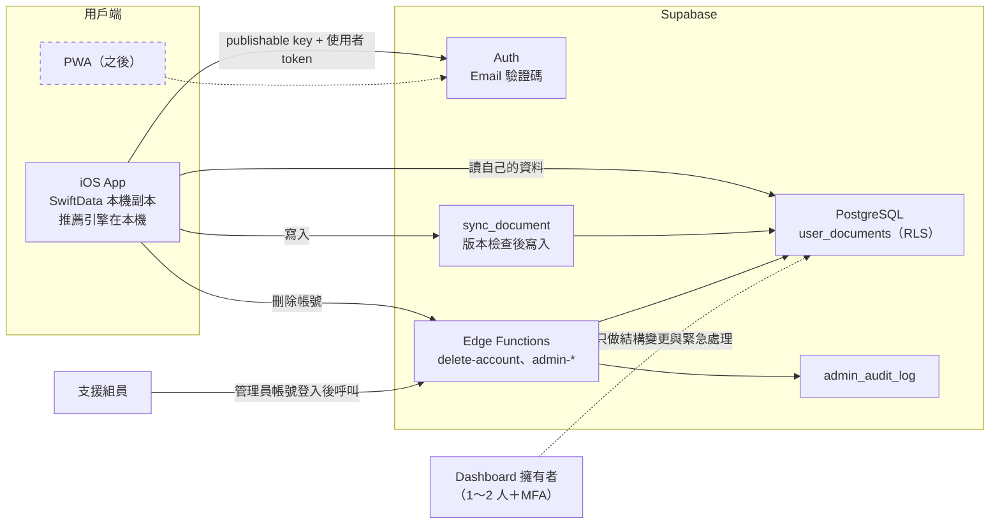

# PackSmart 帳號、雲端同步與管理後台計畫（提案）

日期：2026-10-26。狀態：**設計提案，尚未實作**。對應 PD-062。

## 目標與已確認的需求

團隊確認 PackSmart 需要：

1. **帳號與雲端同步**：換手機資料還在，iOS 和網頁版（PWA）可以讀寫同一趟行程。
2. **管理後台**：授權的組員可以查詢、修正或刪除使用者資料。
3. **私密物品遵守隱私法規**：清單可能包含藥品等敏感內容，蒐集、同意、刪除都要合規。

這三項都需要「帳號＋資料庫＋權限」，所以後端改用 **Supabase**，取代原本規劃的 Cloudflare Worker 與 CloudKit 選配同步（見「與既有設計的關係」）。

## 不變的部分

- **推薦仍在手機上計算**：規則引擎、天氣標籤、原因徽章都不動，沒網路也能建立行程和打包。
- **沒登入的人照常使用**：資料只存在本機 SwiftData，行為和現在一樣。
- **只有明確同意後才上傳**：登入不等於同意同步。
- **不使用雲端 AI**：本提案不包含 AI 功能；要加雲端 AI 必須另寫 PD。
- 新增的登入、同意、帳號畫面依「結構 C 完整版」設計。

## 架構

- App 裡只放 **publishable key**；保護資料靠「登入身分＋RLS」。**service_role／secret key 只存在 Edge Function 伺服器**，不能放進 App、PWA 或 repo。
- 參考資料（規則、用品目錄）是公開資料，繼續內建在 App，不存使用者個資。

## 資料模型

公開的參考資料（規則、目錄）留在 App 裡；私人的使用者資料才放 Supabase。

**`user_documents`**：每趟行程（含清單）或每個常備用品一列。

| 欄位 | 說明 |
|---|---|
| `owner_id` | Auth 的 user ID；伺服器從登入身分取得，不接受用戶端傳入 |
| `kind` | `trip` 或 `library` |
| `id` | 穩定 ID，等於本機 SwiftData 的 UUID |
| `revision` | 每次寫入 +1，用來偵測衝突 |
| `payload` | JSON，`version: 1`；刪除時為空 |
| `deleted` | 刪除標記（tombstone），讓其他裝置知道要刪 |
| `mutation_id` | 每次修改的唯一 ID，網路重試不會重複寫入 |
| `created_at`／`updated_at` | 建立與最後修改時間 |

**`admin_users`**：管理員名單（Auth user ID、角色、加入日期）。

**`admin_audit_log`**：管理員每次操作的紀錄（誰、何時、哪個使用者、哪份資料、動作、原因）。

三張表都開啟並強制 RLS。一般使用者只能讀自己的 `user_documents`，不能直接寫；`admin_users` 和 `admin_audit_log` 對 App 完全不開放，只有 Edge Function 能讀寫。

## 沿用 TravelGenius 的實作

之前在 TravelGenius（個人測試專案）做過一版 Supabase 同步。**這份程式還沒 commit，團隊目前看不到**，實作第 1 步會把它搬進 PackSmart repo，並連同測試一起 review。以下設計已在本機測試過：

| 項目 | 做法 |
|---|---|
| 資料表 | 上面的 `user_documents`，主鍵 `(owner_id, kind, id)` |
| 權限 | 強制 RLS；**不允許直接寫表**，只能透過 `sync_document` |
| 衝突處理 | `sync_document` 比對 `revision`（compare-and-swap），版本不同就回傳衝突讓使用者選擇，不會靜默覆蓋；`mutation_id` 讓重試冪等 |
| 帳號綁定 | 本機資料綁定第一次同步時的「Supabase 專案＋帳號」；登出不清除綁定，避免傳到別人的帳號 |
| 刪除帳號 | `delete-account` Edge Function：驗證 token 後刪除 Auth user，資料以外鍵 cascade 一起刪除 |
| 測試 | Swift 同步回歸測試，以及用 PGlite 在本機跑真的 migration，驗證 RLS、拒絕直接寫入、冪等、cascade |

**不能直接複製，要改的地方**：

- 行程多了偏好、天氣、這趟安排三個快照（`packingPreferencesRaw`、`packingWeatherRaw`、`packingContextRaw`），以及 `excludedPackingIDsRaw`、`packingReviewPending`。快照**原樣上傳**，讓另一台裝置看到同樣的推薦依據。
- 打包項目改用 `catalogItemID`（可為空）和 `unitWeightKg`，不是 `weightGrams`。
- 常備用品改存在 `PackingLibraryStore`（獨立 SwiftData）。

## 同步規則

- **觸發時機**：App 啟動、回到前景、使用者按「立即同步」。第一版沒有即時推送或背景同步。
- **離線修改**：先存本機，記錄待上傳；下次同步時依序上傳，失敗就保留待下次重試。
- **衝突**：兩台裝置都改了同一趟行程時，讓使用者選擇保留哪一版，不會自動覆蓋。
- **刪除**：本機刪除的行程上傳為 `deleted = true`；其他裝置同步時看到刪除標記，就刪除本機副本。另一台同時有修改時，視為衝突讓使用者選。
- **換裝置**：在新手機用同一個帳號登入並同意同步，就會下載全部資料。
- **切換帳號**：第一版不支援。這台裝置的本機資料已綁定帳號 A 時，登入帳號 B 會被擋下並說明原因，可以先匯出資料。

## 私密物品

**預設**：「健康」分類（`health`，含藥品）的用品不上傳。

- **上傳時**：從行程 payload 剔除私密物品，payload 記錄剔除的數量，讓其他裝置可以顯示「這趟有 N 件私密物品只存在原本的手機」。
- **下載時**：套用雲端版本，但保留本機原有的私密物品，不會被蓋掉。
- **取捨**：其他裝置和 PWA 看不到這些物品。使用者可以在設定裡另外同意「同步健康類物品」，同意後才上傳。

**待決定**：要不要讓使用者把自訂用品標記為私密。要做的話，`PackingItem` 需要新增一個欄位。

## 管理後台

**限制**：Supabase Dashboard 的成員可以直接看、改所有資料表，系統擋不住，Dashboard 也不會逐筆記錄誰看了什麼。因此：

1. **Dashboard 擁有者只有 1～2 人**，全部開啟 MFA，只做資料庫結構變更和緊急處理。
2. **日常支援走管理員函式**：其他負責支援的組員不加入 Dashboard。他們用自己的 PackSmart 帳號登入，呼叫 `admin-find-user`、`admin-update-document`、`admin-delete-user` 等 Edge Function。
3. **函式驗證管理員身分**：確認呼叫者在 `admin_users` 名單裡，而且登入時通過 MFA；不符合就回 403。每次操作都寫入 `admin_audit_log`，必須填寫原因。
4. **查看要有理由**：只在處理使用者回報的問題時查看內容，並在隱私權政策裡告知。

第一版沒有管理網頁，用函式加簡單的指令或工具呼叫即可；之後需要的話，再做一個只呼叫這些函式的管理頁面。

## 隱私與法規

台灣《個人資料保護法》把醫療相關資料列為特種個資，蒐集、處理有更嚴格的限制。藥品名稱是否算醫療資料要看情況，**這部分需要請懂法規的人確認**，以下是工程上可以先做的：

- **最小蒐集**：只同步行程和打包清單。支出、醫療隨身卡、照片不上傳。
- **私密物品預設不上傳**（見上方「私密物品」）。
- **明確同意**：開啟同步時說明上傳哪些資料、存在哪個地區、誰看得到（含授權管理員）。
- **使用者的權利**：App 內可以匯出資料、刪除雲端資料、刪除帳號。Apple 也要求有帳號的 App 必須能在 App 內刪除帳號。
- **刪除帳號的範圍**：刪除**雲端**帳號和全部雲端資料；手機上的本機資料保留，使用者可以另外清除。關閉同步、登出、移除 App 都不等於刪除雲端帳號。
- **資料地區**：Supabase 專案建立時選地區（例如東京或新加坡），隱私權政策要寫明資料存放在國外。
- **保留期限**：刪除帳號後雲端資料立即刪除；備份的保留期限依平台設定，要寫進政策。

## 與既有設計的關係

**CloudKit 選配同步（PD-060）**：由 Supabase 取代。

- 目前 `PackingLibraryStore` 只有在簽章版本設定了 container 時才會開 CloudKit。repo 裡從來沒有設定過 container 或 iCloud entitlement，所以**正式版不會有使用者資料在 iCloud 裡**，不需要搬移遠端資料。
- 實作 Supabase 同步時，移除 `PackingLibraryStore` 的 CloudKit 選項，避免同時寫入 CloudKit 和 Supabase。
- 發布前用已有本機資料的測試裝置做原地升級，確認舊資料可以正常開啟。

**Cloudflare Worker（`feature/cloudflare-worker`）**：暫停、不合併。

| Worker 原本的工作 | 改成 |
|---|---|
| 發布參考資料 | 繼續內建在 App；需要遠端更新時另外決定放哪裡 |
| 轉發 AI 冷知識 | 不在本提案範圍；雲端 AI 需要另寫 PD |

## 部署與營運

- **兩個專案**：一個測試、一個正式。免費方案最多 2 個啟用中的專案，剛好夠用。資料庫結構變更一律寫成 migration，先在測試專案驗證，再推正式專案。
- **免費方案的限制**（依 2026-10-11 查閱的官方價格頁）：
  - 資料庫 500 MB、檔案 1 GB、每月 50,000 活躍使用者，50 人以內很夠用。
  - **一週沒有使用會暫停專案**，展示前要確認專案是開著的。
  - **沒有自動備份**，要定期用 `pg_dump` 手動匯出，並實際演練還原。
  - **內建寄信每小時只能寄 2 封**，只適合開發；給一般使用者測試前要設定自訂 SMTP（寄信服務可能另外收費）。
- **升級成本**：Pro 方案每月 US$25 起，有自動備份、不會暫停。
- **監控**：定期查看 Supabase 的 Auth、資料庫、Edge Function 錯誤紀錄，以及容量和寄信額度。

## 實作步驟（建議順序）

1. **資料庫**：把 TravelGenius 的 migration、`sync_document`、`delete-account` 搬進 PackSmart repo，加上 PackSmart 的 payload 驗證、`admin_users`、`admin_audit_log`；PGlite 測試先通過。
2. **iOS 同步**：登入、同意畫面、同步引擎，改寫成 PackSmart 的模型；移除 CloudKit 選項；同步回歸測試通過。
3. **隱私**：私密物品剔除與保留、匯出、刪除帳號；新增隱私權政策和 `PrivacyInfo.xcprivacy`（PackSmart 目前還沒有）。
4. **管理員函式**：`admin-*` 函式、管理員身分與 MFA 檢查、稽核紀錄。
5. **連上 Supabase 測試專案**：兩個帳號、兩台裝置實測。
6. **PWA**：之後另外規劃，共用同一個 Auth 和資料表。

## 驗收條件

- 兩個使用者彼此看不到對方的資料；直接寫資料表會被拒絕。
- 同一個帳號在兩台 iOS 裝置讀寫同一趟行程；PWA 階段也要能讀寫同一趟。
- 離線修改後重新連線，衝突時會讓使用者選擇，資料不遺失；刪除會同步到另一台裝置。
- 私密物品在使用者另外同意之前不會出現在雲端，下載雲端版本時也不會被刪掉。
- 不在 `admin_users` 的帳號呼叫管理員函式會被拒絕（403）；管理員的每次操作都有稽核紀錄。
- App 和 repo 裡找不到 service_role key。
- 刪除帳號後，雲端資料確實清除。
- 沒有登入時，2,916 組推薦相容性測試和 540 組矩陣測試結果不變。

## 待團隊決定

1. **登入方式**：只用 Email 驗證碼（建議先這樣），還是也加 Apple 登入？
2. **誰當 Dashboard 擁有者、誰當支援管理員**？
3. **自訂用品可以標記為私密嗎**？要的話需要新增欄位。
4. **法規確認**：誰負責確認個資法的要求，以及撰寫隱私權政策？
5. **資料地區**：東京或新加坡？
