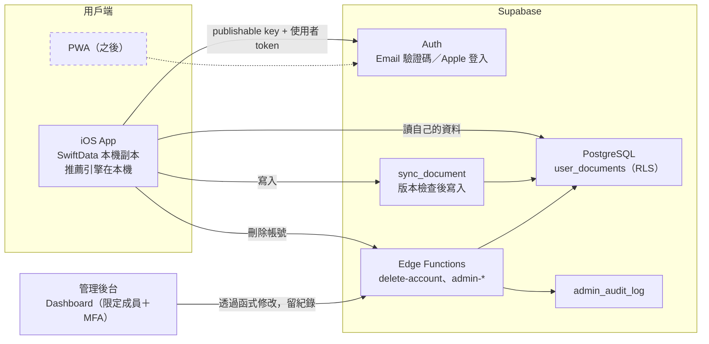

# PackSmart 帳號、雲端同步與管理後台計畫（提案）

日期：2026-10-26。狀態：**設計提案，尚未實作**。對應 PD-062。

## 目標與已確認的需求

團隊確認 PackSmart 需要：

1. **帳號與雲端同步**：換手機資料還在，iOS 和網頁版（PWA）可以讀寫同一趟行程。
2. **管理後台**：授權的組員可以查詢、修正或刪除使用者資料。
3. **私密物品遵守隱私法規**：清單可能包含藥品等敏感內容，蒐集、同意、刪除都要合規。

這三項都需要「帳號＋資料庫＋權限」，所以後端改用 **Supabase**，取代原本規劃的 Cloudflare Worker（見下方「與 Cloudflare Worker 的關係」）。

## 不變的部分

- **推薦仍在手機上計算**：規則引擎、天氣標籤、原因徽章都不動，沒網路也能建立行程和打包。
- **沒登入的人照常使用**：資料只存在本機 SwiftData，行為和現在一樣。
- **只有明確同意後才上傳**：登入不等於同意同步。

## 架構

- App 裡只放 **publishable key**；保護資料靠「登入身分＋RLS」。**service_role／secret key 只存在 Edge Function 伺服器**，不能放進 App、PWA 或 repo。
- 參考資料（規則、用品目錄）是公開資料，繼續內建在 App；之後要遠端更新，再放 Supabase Storage，沿用現有的 manifest／SHA-256 整包驗證。

## 沿用 TravelGenius 的實作

之前在 TravelGenius（個人測試專案）做過一版 Supabase 同步，程式還沒 commit，在本機的 `bream` 工作區。以下設計已經過本地測試，可以搬過來：

| 項目 | 做法 |
|---|---|
| 資料表 | `user_documents`：每趟行程（含完整清單）或每個常備用品存成一列 JSON；主鍵 `(owner_id, kind, id)` |
| 權限 | 開啟並強制 RLS，使用者只能讀自己的資料；**不允許直接寫表**，只能透過 `sync_document` |
| 衝突處理 | `sync_document` 比對版本（compare-and-swap），版本不同就回傳衝突，讓使用者選擇，不會靜默覆蓋；`mutation_id` 讓重試不重複寫入 |
| 帳號綁定 | 本機資料綁定第一次同步的帳號；登出不清除綁定，避免傳到別人的帳號 |
| 刪除帳號 | `delete-account` Edge Function：驗證 token 後刪除 Auth user，資料表以外鍵 cascade 一起刪除 |
| 測試 | Swift 同步回歸測試，以及用 PGlite 在本機跑真的 migration，驗證 RLS、拒絕直接寫入、冪等、cascade |

**不能直接複製，要改的地方**：PackSmart 的資料模型已經和 TravelGenius 不同。

- 行程多了偏好、天氣、這趟安排三個快照（`packingPreferencesRaw`、`packingWeatherRaw`、`packingContextRaw`），以及 `excludedPackingIDsRaw`、`packingReviewPending`。
- 打包項目改用 `catalogItemID`（可為空）和 `unitWeightKg`，不是 `weightGrams`。
- 常備用品改存在 `PackingLibraryStore`（獨立 SwiftData）。

因此 PackSmart 要定義自己的 payload `version: 1`，快照**原樣上傳**，讓另一台裝置看到同樣的推薦依據。

## 管理後台

Supabase 內建的 Dashboard（Table Editor）就能查詢資料，不用另外寫後台網站。但要加上這些限制：

1. **限定成員**：只有負責營運的組員加入 Supabase 專案，全部開啟 MFA。
2. **修改要留紀錄**：需要修改或刪除使用者資料時，透過 `admin-update-document`／`admin-delete-user` 這類 Edge Function 執行，每次寫入 `admin_audit_log`（誰、何時、哪個使用者、原因）。不在 Table Editor 直接改資料。
3. **查看要有理由**：只在處理使用者回報的問題時查看內容，並在隱私權政策裡告知。

**待決定**：Dashboard 的「查看」無法逐筆留紀錄。如果要求連查看都要稽核，就要另外做唯讀的管理介面，讓查詢也經過函式。

## 隱私與法規

台灣《個人資料保護法》把醫療相關資料列為特種個資，蒐集、處理有更嚴格的限制。藥品名稱是否算醫療資料要看情況，**這部分需要請懂法規的人確認**，以下是工程上可以先做的：

- **最小蒐集**：只同步行程和打包清單。支出、醫療隨身卡、照片、AI 同意紀錄不上傳（沿用 TravelGenius 的範圍）。
- **私密物品不上傳**：「健康」分類（`health`，含藥品）的用品，以及使用者標記為私密的自訂用品，預設只存在本機；使用者另外同意才同步。
- **明確同意**：開啟同步時說明上傳哪些資料、存在哪個地區、誰看得到（含授權管理員）。
- **使用者的權利**：App 內可以匯出資料、刪除雲端資料、刪除帳號。Apple 也要求有帳號的 App 必須能在 App 內刪除帳號。
- **資料地區**：Supabase 專案建立時選地區（例如東京或新加坡），隱私權政策要寫明資料存放在國外。
- **保留期限**：刪除帳號後立即刪除資料；備份的保留期限依平台設定，要寫進政策。

## 與 Cloudflare Worker 的關係

`feature/cloudflare-worker` 原本負責兩件事，都改由 Supabase 或 App 處理，因此**暫停、不合併**：

| Worker 原本的工作 | 改成 |
|---|---|
| 發布參考資料 | 繼續內建在 App；需要遠端更新時放 Supabase Storage |
| 轉發 AI 冷知識 | 需要時改寫成 Supabase Edge Function，API key 只放伺服器端 |

Worker 的設計（地點白名單、快取、每日上限）可以在寫 Edge Function 時參考。

## 免費方案的限制

依 2026-10-11 查閱的官方價格頁：

- 資料庫 500 MB、檔案 1 GB、每月 50,000 活躍使用者，50 人以內很夠用。
- **一週沒有使用會暫停專案**，展示前要確認專案是開著的。
- **沒有自動備份**，要自己定期匯出。
- **內建寄信每小時只能寄 2 封**，只適合開發；給一般使用者測試前要設定自訂 SMTP。

## 實作步驟（建議順序）

1. **資料庫**：搬入 `user_documents`、`sync_document`、`delete-account`，加上 PackSmart 的 payload 驗證；PGlite 測試先通過。
2. **iOS 同步**：登入、同意畫面、同步引擎，改寫成 PackSmart 的模型；同步回歸測試通過。
3. **隱私**：私密物品不上傳、匯出、刪除帳號；新增隱私權政策和 `PrivacyInfo.xcprivacy`（PackSmart 目前還沒有）。
4. **管理後台**：管理用 Edge Function、`admin_audit_log`、Dashboard 成員與 MFA 設定。
5. **連上真正的 Supabase 測試專案**：兩個帳號、兩台裝置實測。
6. **PWA**：之後另外規劃，共用同一個 Auth 和資料表。

## 驗收條件

- 兩個使用者彼此看不到對方的資料；直接寫資料表會被拒絕。
- 同一個帳號在兩台裝置讀寫同一趟行程；離線修改後重新連線，衝突時會讓使用者選擇，資料不遺失。
- 私密物品在使用者另外同意之前不會出現在雲端。
- 管理員的修改都有稽核紀錄；App 和 repo 裡找不到 service_role key。
- 刪除帳號後，雲端資料確實清除。
- 沒有登入時，2,916 組推薦相容性測試和 540 組矩陣測試結果不變。

## 待團隊決定

1. **登入方式**：只用 Email 驗證碼（建議先這樣），還是也加 Apple 登入？
2. **誰當管理員**：哪幾位組員加入 Supabase 專案？
3. **查看是否也要稽核**：如果要，就要另做唯讀的管理介面。
4. **私密物品的範圍**：「健康」分類全部預設不上傳就好，還是讓使用者自己標記？
5. **法規確認**：誰負責確認個資法的要求，以及撰寫隱私權政策？
6. **資料地區**：東京或新加坡？
